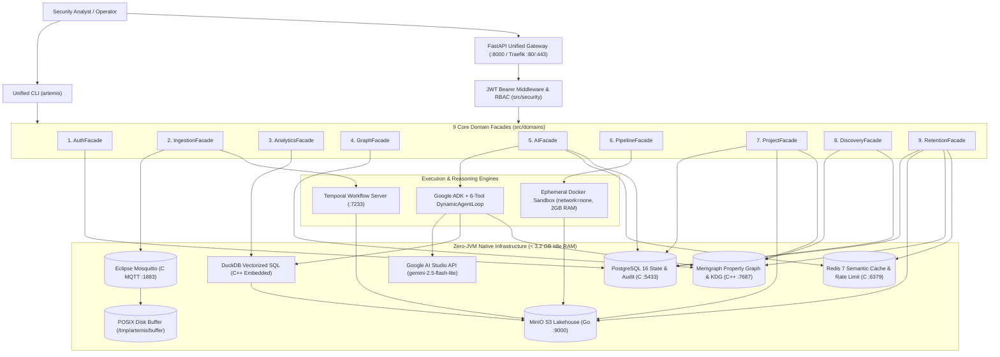

# Poor Man's Defense Lakehouse — Documentation Hub

**Sovereign Big Data Lakehouse, Universal Knowledge Discovery Graph & Autonomous AI Infostructure on a Single Linux VM**

---

## 🌐 Interactive Visual Explorers (HTML5 Suite)

Explore the architecture, live packet flows, multi-database AI agent loops, and zero-trust Knowledge Discovery Graph through our self-contained interactive HTML applications:

| Interactive Application | Path | What You Can Explore |
| :--- | :--- | :--- |
| **1. System & 8-Domain Architecture Command Center** | [`docs/index.html`](index.html) | Interactive Zero-JVM infrastructure topology, 8 hexagonal domain facades, RAM budget calculator (Traditional JVM vs. Artemis C/C++/Go), and searchable catalog of all **34 REST API routes** & **CLI commands**. |
| **2. Sovereign Deployment Topology & Container Specs** | [`docs/interactive/deployment_topology.html`](interactive/deployment_topology.html) | Dedicated interactive 4-zone SVG deployment diagram (`artemis-net` Docker bridge, Host Python/C++ runtime, Air-Gapped `network_mode="none"` sandbox, and External/Cloud boundary) with detailed per-component specs, ports, volumes, env vars, and security posture for all **14 deployment units**. |
| **3. End-to-End Flow & Sequence Simulator** | [`docs/interactive/system_flows.html`](interactive/system_flows.html) | Step-by-step animated packet player for **5 core operational flows**: (1) MQTT-to-Parquet Compaction, (2) 6-Tool Autonomous AI Agent Loop (`artemis ask`), (3) Medallion Docker Sandbox Execution, (4) Two-Phase KDG Indexing & Entity Resolution, and (5) Fail-Fast Production vs. Pytest Mock Harness. |
| **4. Knowledge Discovery Graph & RBAC Sandbox** | [`docs/interactive/knowledge_discovery_explorer.html`](interactive/knowledge_discovery_explorer.html) | Interactive force-directed KDG canvas, live **Zero-Trust User/Role Confinement Switcher** (`alice`, `bob`, `eve`, `admin`), cross-project `SAME_AS` entity linker (`Rapidfuzz` + `DSU`), dataset lineage tracer, and regex `PatternProfiler` sandbox. |

> **Tip**: Open [`docs/index.html`](index.html) directly in any browser or serve locally via `python3 -m http.server 8090 --bind 127.0.0.1 --directory docs`.

---

## 📐 Architecture & Deep-Dive Guides (`docs/architecture/`)

| Document | Feature Alignment | Summary |
| :--- | :--- | :--- |
| [**Microservice Domain Architecture**](architecture/microservice_domain_architecture.md) | `002-uservice-alignment` `005-knowledge-discovery-graph` `006-remove-production-mocks` `009-dataset-ttl-cleanup` | Hexagonal DDD architecture aligned with `uservice-template`, detailing all **9 core domains** (`auth`, `ingestion`, `analytics`, `graph`, `ai`, `pipeline`, `project`, `discovery`, `retention`), **46 FastAPI endpoints**, Temporal workflows, Google ADK 2.0 agents, and fail-fast exception boundaries. |
| [**Dataset & Query Data TTL Retention & Cleanup**](architecture/dataset_ttl_and_cleanup.md) | `009-dataset-ttl-cleanup` | 4-tier TTL policy hierarchy, per-file ingestion clocks vs. `TIMESTAMP_COLUMN` row granularity, transparent DuckDB SQL & Cypher read-time interception, source-aware query cache invalidation, two-stage `SOFT_DELETED` grace period with single-pass Parquet compaction, reference-counted Memgraph entity pruning, and `:LineageTombstone` provenance preservation. |
| [**Universal Knowledge Discovery Graph (KDG) Guide**](architecture/knowledge_discovery_graph_guide.md) | `005-knowledge-discovery-graph` | Federated semantic metadata overlay in Memgraph: 6 node types (`Workspace`, `DataResource`, `DataAttribute`, `GenericEntity`, `SemanticTaxonomy`, `PipelineExecution`), 2-phase indexing (`StructuralIndexer` + `KDGEnrichmentWorkflow`), Rapidfuzz + DSU entity resolution, and zero-trust membership confinement. |
| [**Project Data Pipelines & Medallion Sandbox**](architecture/project_data_pipelines.md) | `004-project-data-pipelines` | Multi-tier Medallion lakehouse (`BRONZE`, `SILVER`, `GOLD`), AST script validation (`ast.parse`), ephemeral rootless Docker runner (`artemis-pipeline-runner:latest` with `--network=none`, `--memory=2g`, `--cpus=2.0`), and DuckDB S3 prefix confinement. |
| [**Data Ingestion Architecture & Operations**](architecture/data_ingestion_guide.md) | `001-simplified-artemis` `004-project-data-pipelines` `005-knowledge-discovery-graph` | Three ingestion tracks: (1) High-frequency MQTT telemetry (`tools/simulate_telemetry.py` $\rightarrow$ disk buffer $\rightarrow$ atomic rotation $\rightarrow$ Snappy Parquet $\rightarrow$ MinIO), (2) SpiderFoot OSINT graph import, and (3) Project-scoped tabular/graph ingestion with synchronous KDG Phase 1 profiling. |
| [**Autonomous AI RAG & 6-Tool Loop (`artemis ask`)**](architecture/ai_rag_scenario.md) | `003-dynamic-agent-tools` `005-knowledge-discovery-graph` | Multi-turn Gemini Function Calling loop across DuckDB, Memgraph, and the Knowledge Discovery Graph using 6 read-only tools (`query_analytics`, `query_graph`, `get_schema_info`, `discover_workspace_schema`, `find_cross_project_entities`, `get_data_lineage`), AST safety guardrails, Redis semantic cache, and PostgreSQL audit logging. |
| [**Google AI Studio Integration & Fail-Fast Design**](architecture/google_ai_studio_integration.md) | `001-simplified-artemis` `006-remove-production-mocks` | Architectural justification for offloading LLM inference to `gemini-2.5-flash-lite` on CPU-only VMs, explicit fail-fast exceptions (`ConfigurationError`, `ServiceUnavailableError`), and deterministic offline testing via `MockGenAIClient`. |
| [**Clean Production Architecture & Testing Harness**](architecture/clean_architecture_and_testing.md) | `006-remove-production-mocks` | Zero-mock production codebase principles, typed domain exception hierarchy (`src/core/exceptions.py`), sub-second socket pre-checks, and the 6 reusable in-memory test doubles in `tests/fixtures/mocks/`. |
| [**Foundational KDG Research & Ontology Brief**](architecture/ideas/knowledge_discovery_graph.md) | `005-knowledge-discovery-graph` | Original architectural analysis comparing static metadata catalogs vs. active semantic discovery graphs across arbitrary data types. |

---

## 🗺️ System Topology at a Glance

---

## 📋 Feature Evolution Matrix (`specs/001` – `009`)

| Spec ID | Feature Name | Key Deliverables |
| :--- | :--- | :--- |
| **`001-simplified-artemis`** | Core Zero-JVM Lakehouse Prototype | Mosquitto MQTT listener, POSIX disk buffer, PyArrow Snappy Parquet writer, MinIO S3 storage, embedded DuckDB SQL, Memgraph OSINT importer, Redis semantic cache, PostgreSQL audit log, and `artemis` CLI. |
| **`002-uservice-alignment`** | Hexagonal Microservice Alignment | Refactored into `src/domains/<domain>/{api,facade,models,operations}`, FastAPI unified gateway (`src/api.py`), JWT authentication (`artemis login` / `artemis whoami`), Temporal workflows, Google ADK agent pipeline, and Langfuse OpenTelemetry tracing. |
| **`003-dynamic-agent-tools`** | Autonomous Multi-Database Agent Loop | `DynamicAgentLoop` with multi-turn Gemini Function Calling across DuckDB (`query_analytics`), Memgraph (`query_graph`), and schema reflection (`get_schema_info`), enforced by read-only AST/keyword guardrails. |
| **`004-project-data-pipelines`** | Isolated Projects & Medallion Sandboxes | Multi-tenant project workspaces (`BRONZE`, `SILVER`, `GOLD`), tabular & graph project ingestion, AST-validated shareable Python pipelines, rootless ephemeral Docker runner (`artemis-pipeline-runner:latest`), and DuckDB S3 prefix confinement. |
| **`005-knowledge-discovery-graph`** | Universal Knowledge Discovery Graph | Domain-agnostic KDG ontology in Memgraph, 2-phase indexing (`StructuralIndexer` + `PatternProfiler` & `KDGEnrichmentWorkflow`), `Rapidfuzz` + DSU cross-project entity resolution, dataset lineage tracking, zero-trust `project_members` RBAC, `artemis discover` CLI, and 3 new AI discovery tools. |
| **`006-remove-production-mocks`** | Clean Production Architecture | Purged all test/simulation fallbacks from `src/`, introduced fail-fast typed exceptions (`ConfigurationError`, `ConnectionError`, `ServiceUnavailableError`), relocated `simulate_telemetry.py` to `tools/`, and built 6 reusable test doubles in `tests/fixtures/mocks/`. |
| **`007-infra-architecture-remediation`** | Infrastructure & Architecture Hardening | Consolidated zero-JVM container orchestration, health checks, and deployment topology docs. |
| **`008-repo-sanitization-rename`** | Repository Sanitization & Sovereignty | Automated PII/IP redaction and repository sanitization tooling (`tools/sanitize_repo.py`). |
| **`009-dataset-ttl-cleanup`** | Dataset & Query Data TTL Retention & Cleanup | `RetentionDomain` (`RetentionFacade`), 4-tier TTL hierarchy (`DATASET` > `TIER` > `PROJECT` > `PLATFORM`), per-file `ingested_at` vs. `TIMESTAMP_COLUMN` row granularity, transparent SQL/Cypher `QueryTTLInterceptor`, query artifact governance & source-aware cache invalidation, two-stage `SOFT_DELETED` grace period with single-pass Parquet compaction, active lease protection, reference-counted Memgraph entity pruning, `:LineageTombstone` preservation, and `artemis project ttl` CLI (190/190 tests passing). |
