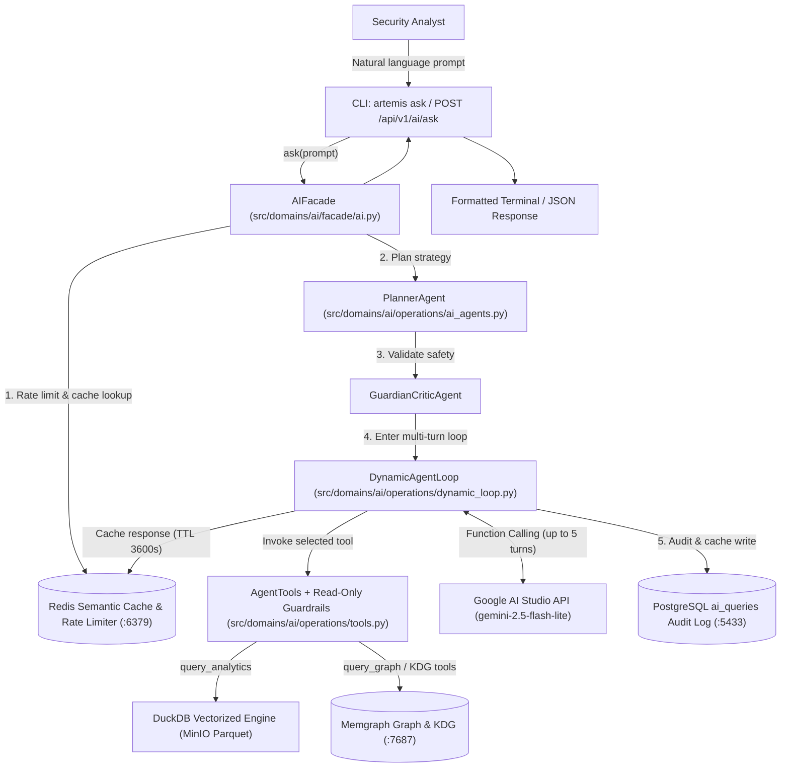
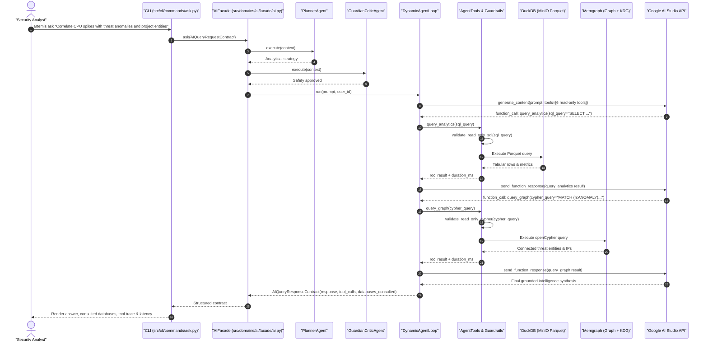

# End-to-End Scenario Flow: `artemis ask`

This document details the business logic, multi-agent orchestration, 6-tool autonomous execution loop, safety guardrails, and sequence flow for the Artemis AI natural language intelligence command:

```bash
artemis ask "What are the common IP addresses associated with recent anomalies?"
artemis ask "Which projects reference account ACCT-99812 and what is its lineage?"
```

---

## 1. High-Level Architecture Flow

The command executes an **autonomous multi-database agent loop** orchestrated by Google ADK 2.0 and `gemini-2.5-flash-lite` with zero local GPU/LLM memory overhead:
1. **CLI / REST Entry**: Analyst submits a natural language inquiry via `artemis ask` or `POST /api/v1/ai/ask`.
2. **Rate Limiting & Semantic Caching**: [`QueryCache`](src/services/ai/cache.py) enforces a 60 req/min sliding window per analyst and checks Redis for a cached SHA-256 prompt match (1-hour TTL).
3. **ADK Multi-Agent Guardrails**: [`PlannerAgent`](src/domains/ai/operations/ai_agents.py) formulates an inquiry strategy and [`GuardianCriticAgent`](src/domains/ai/operations/ai_agents.py) validates safety boundaries.
4. **6-Tool Dynamic Agent Loop**: [`DynamicAgentLoop`](src/domains/ai/operations/dynamic_loop.py) runs up to `MAX_AGENT_TURNS = 5` turns of Gemini Function Calling across **6 read-only tools** in [`AgentTools`](src/domains/ai/operations/tools.py):
   - `query_analytics(sql_query)` $\rightarrow$ DuckDB over MinIO Parquet.
   - `query_graph(cypher_query)` $\rightarrow$ Memgraph threat intelligence graph.
   - `get_schema_info(target)` $\rightarrow$ DuckDB & Memgraph schema introspection.
   - `discover_workspace_schema(project_id)` $\rightarrow$ KDG intra-project dataset/attribute/taxonomy summary.
   - `find_cross_project_entities(value, entity_type, fuzzy)` $\rightarrow$ KDG cross-project entity correlation (scoped to caller's `member_projects`).
   - `get_data_lineage(project_id, dataset_id, depth)` $\rightarrow$ KDG upstream/downstream dataset provenance.
5. **Grounded Synthesis & Audit Trail**: Final synthesis is cached in Redis and logged with full `tool_calls` and `databases_consulted` metadata in PostgreSQL (`ai_queries`).



---

## 2. Step-by-Step Multi-Turn Sequence Diagram



---

## 3. Read-Only AST & Keyword Guardrails

Implemented in [`src/domains/ai/operations/guardrails.py`](src/domains/ai/operations/guardrails.py):
- **SQL Guardrail (`validate_read_only_sql`)**: Blocks any SQL statement containing mutating or administrative keywords (`DROP`, `DELETE`, `INSERT`, `UPDATE`, `ALTER`, `TRUNCATE`, `CREATE`, `REPLACE`, `GRANT`, `REVOKE`, `ATTACH`, `DETACH`, `COPY`, `PRAGMA`, `INSTALL`, `LOAD`).
- **Cypher Guardrail (`validate_read_only_cypher`)**: Blocks any openCypher query containing graph-mutating clauses (`CREATE`, `MERGE`, `DELETE`, `DETACH`, `SET`, `REMOVE`, `DROP`, `LOAD CSV`, `CALL dbms`).
- **KDG Membership Confinement**: All 3 KDG tools (`discover_workspace_schema`, `find_cross_project_entities`, `get_data_lineage`) resolve `member_projects` for the active user via `DiscoveryFacade`, ensuring the AI agent can never read or infer metadata from unauthorized projects.

---

## 4. Fail-Fast Error Handling Matrix (`Feature 006`)

Production AI components never mask outages with simulated data. All failures surface immediately via typed exceptions from [`src/core/exceptions.py`](src/core/exceptions.py):

| Condition | Exception Raised | CLI Exit Code | Diagnostic Behavior |
| :--- | :--- | :--- | :--- |
| Missing or placeholder `GOOGLE_AI_STUDIO_API_KEY` | `ConfigurationError(key="google_api_key")` | `1` | Immediately alerts operator that the API key is unconfigured. |
| Gemini API network failure or quota error | `ServiceUnavailableError(service="gemini")` | `1` | Surfaces upstream API failure without generating fake answers. |
| Memgraph container unreachable (`:7687`) | `ConnectionError(host, port=7687)` | `2` | Sub-second TCP socket pre-check fails fast without hanging. |
| Redis or PostgreSQL unreachable | `ConnectionError` / `ServiceUnavailableError` | `1` | Reports exact infrastructure dependency fault. |
| Analyst exceeds 60 queries/minute | `PermissionError("Rate limit exceeded")` | `1` | Blocks request before invoking Gemini API. |
