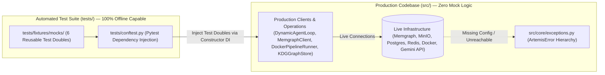
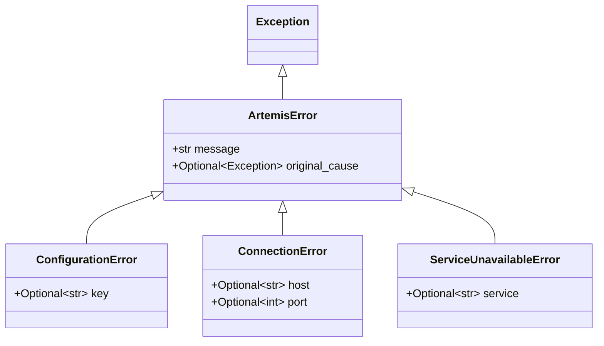

# Clean Production Architecture & Decoupled Test Harness (`Feature 006`)

This document details the architectural principles, exception hierarchy, fail-fast connectivity checks, and isolated pytest mock harness introduced in **`006-remove-production-mocks`**.

---

## 1. Core Architectural Principle: Zero Mocks in `src/`

In mission-critical intelligence and data platforms, embedding test simulation loops, `mock_mode` flags, or in-memory fallback dictionaries inside production modules (`src/`) creates severe operational hazards:
- **Silent Outage Masking**: If Memgraph, Redis, PostgreSQL, Docker, or Google AI Studio goes offline during an incident, fallback heuristics can return synthetic or incomplete answers disguised as valid intelligence.
- **Interface Pollution**: Constructor signatures cluttered with `mock_mode: bool = False` violate the Single Responsibility Principle.

To eliminate these risks, **Poor Man's Defense Lakehouse** enforces a strict architectural boundary verified by [`tests/unit/test_clean_architecture.py`](tests/unit/test_clean_architecture.py):
1. **100% Pure Production Code (`src/`)**: Zero `mock_mode` parameters, zero `_run_simulated_loop` methods, zero embedded fake stores, and zero synthetic load generators in `src/`.
2. **Explicit Fail-Fast Domain Exceptions (`src/core/exceptions.py`)**: All missing credentials, unreachable daemons, and upstream service errors immediately raise typed domain exceptions.
3. **Isolated Test Doubles (`tests/fixtures/mocks/`)**: All offline simulation logic and in-memory test stores reside strictly under `tests/fixtures/mocks/` and are wired via dependency injection in [`tests/conftest.py`](tests/conftest.py).

---

## 2. Typed Exception Hierarchy (`src/core/exceptions.py`)

Defined in [`src/core/exceptions.py`](src/core/exceptions.py):

| Exception Class | When Raised | Examples in `src/` |
| :--- | :--- | :--- |
| **`ConfigurationError`** | Required credentials, API keys, or settings are missing or set to placeholder values at initialization. | `GenAIService` and `DynamicAgentLoop` when `GOOGLE_AI_STUDIO_API_KEY` is unset or equals `your_google_ai_studio_api_key_here`. |
| **`ConnectionError`** | A backing infrastructure daemon fails a fast TCP pre-check or driver handshake. | `MemgraphClient` (`:7687`), `KDGGraphStore` (`:7687`), `QueryCache` (`:6379`), `AuditLogger` (`:5433`), `IndexJobRepository` (`:5433`). |
| **`ServiceUnavailableError`** | An upstream runtime operation fails during execution. | `DynamicAgentLoop.run()` (`service="gemini"`), `DockerPipelineRunner.run_container()` (`service="docker"`), `MemgraphClient.execute_query()` (`service="memgraph"`). |

---

## 3. Reusable Test Doubles (`tests/fixtures/mocks/`)

All offline test simulation resides in [`tests/fixtures/mocks/`](tests/fixtures/mocks) and is verified directly by [`tests/unit/test_mock_fixtures.py`](tests/unit/test_mock_fixtures.py):

| Test Double Class | File | Production Target | Capabilities |
| :--- | :--- | :--- | :--- |
| **`MockGenAIClient`** | [`mock_genai.py`](tests/fixtures/mocks/mock_genai.py) | `google.genai.Client` | Simulates multi-turn Gemini Function Calling across all 6 `AgentTools` and grounded text synthesis. |
| **`MockMemgraphClient`** | [`mock_memgraph.py`](tests/fixtures/mocks/mock_memgraph.py) | `MemgraphClient` | In-memory property graph storing nodes, edges, OSINT imports, and Cypher entity lookups. |
| **`MockKDGGraphStore`** | [`mock_kdg_store.py`](tests/fixtures/mocks/mock_kdg_store.py) | `KDGGraphStore` | Full in-memory KDG graph store supporting workspace summaries, `SAME_AS` entity resolution, lineage traversal, and membership filtering. |
| **`MockDockerRunner`** | [`mock_docker.py`](tests/fixtures/mocks/mock_docker.py) | `DockerPipelineRunner` | Executes pipeline Python scripts in isolated local temporary `/workspace/input` and `/workspace/output` directories with timeout enforcement. |
| **`MockQueryCache`** | [`mock_cache.py`](tests/fixtures/mocks/mock_cache.py) | `QueryCache` | In-memory dictionary semantic cache and sliding-window rate limiter. |
| **`MockAuditLogger`** | [`mock_audit.py`](tests/fixtures/mocks/mock_audit.py) | `AuditLogger` | In-memory audit log recorder for verifying `ai_queries` entries in tests. |
