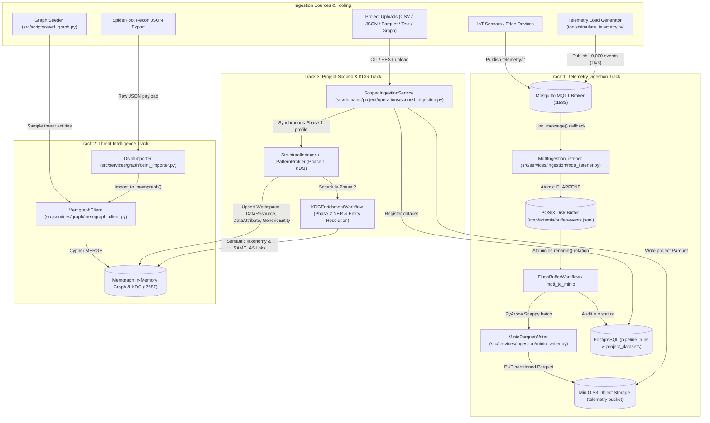
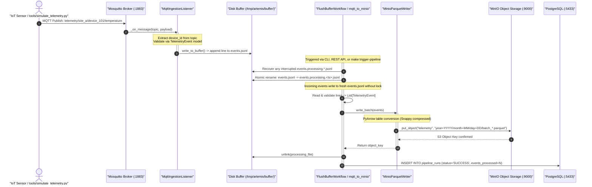

# Data Ingestion Architecture & Operations Guide

This document describes the complete data ingestion architecture of the **Poor Man's Defense Lakehouse** platform across all three operational ingestion channels:

1. **High-Frequency Telemetry Ingestion (IoT/Edge)**: Fast MQTT streaming $\rightarrow$ crash-resilient POSIX disk buffering $\rightarrow$ atomic batch rotation $\rightarrow$ Apache Arrow/Snappy Parquet compaction $\rightarrow$ MinIO S3 object lake.
2. **Threat Intelligence / OSINT Ingestion**: SpiderFoot JSON reconnaissance exports $\rightarrow$ entity & relationship disambiguation $\rightarrow$ idempotent openCypher Bolt `MERGE` $\rightarrow$ Memgraph knowledge graph.
3. **Project-Scoped Multi-Tier Ingestion & KDG Profiling**: Heterogeneous tabular (CSV, JSON, Parquet), unstructured text, and graph ingestion into isolated project workspaces (`BRONZE`, `SILVER`, `GOLD`), paired with synchronous Phase 1 Knowledge Discovery Graph (`StructuralIndexer` + `PatternProfiler`) indexing.

---

## 1. High-Level Architecture Overview



---

## 2. Track 1: High-Frequency Telemetry Ingestion

### 2.1 Design Philosophy: Decoupled Buffering
IoT and tactical sensor streams produce thousands of events per second. Writing each event individually to S3 object storage would introduce severe HTTP overhead and create millions of tiny files ("small file problem").

Artemis solves this via a **two-tier architecture**:
1. **Tier 1 (Fast Ingress)**: [`MqttIngestionListener`](src/services/ingestion/mqtt_listener.py) subscribes to `telemetry/#` on Mosquitto (`:1883`), validates each message against [`TelemetryEvent`](src/services/ingestion/models.py), and appends JSON lines directly to `/tmp/artemis/buffer/events.jsonl`.
2. **Tier 2 (Batch Compaction)**: [`FlushBufferWorkflow`](src/domains/ingestion/operations/flush.py) / [`mqtt_to_minio.py`](src/pipelines/mqtt_to_minio.py) atomically rotates the buffer file, converts batches to columnar Snappy-compressed Parquet files in memory via Apache Arrow, and uploads them to date-partitioned S3 keys in MinIO.

### 2.2 Sequence Diagram: Telemetry Flow



### 2.3 Load Generator Tooling (`Feature 006` Alignment)
In accordance with `Feature 006` (`006-remove-production-mocks`), synthetic load generation is cleanly separated from the `src/` production package and resides in [`tools/simulate_telemetry.py`](tools/simulate_telemetry.py). Invoking `make simulate-telemetry` publishes 10,000 synthetic telemetry events at 1,000 events/sec.

---

## 3. Track 2: Threat Intelligence & OSINT Ingestion

### 3.1 SpiderFoot Reconnaissance Parsing & OpenCypher Upsert
- **Parser**: [`OsintImporter.parse_spiderfoot_json()`](src/services/graph/osint_importer.py) extracts unique nodes (`IP_ADDRESS`, `DOMAIN_NAME`, `SUBDOMAIN`, `NETBLOCK`, `ASN`) and infers directed relationships (`RESOLVES_TO`, `SUBDOMAIN_OF`, `ASSOCIATED_WITH`).
- **Idempotent Bolt Injection**: [`MemgraphClient`](src/services/graph/memgraph_client.py) performs a fast TCP socket pre-check before executing parameterized openCypher `MERGE` queries over `bolt://localhost:7687`. If Memgraph is unreachable, it immediately raises a typed `ConnectionError` (`src/core/exceptions.py`).

---

## 4. Track 3: Project-Scoped Multi-Tier Ingestion & KDG Profiling

When data is ingested into a project workspace via [`ScopedIngestionService`](src/domains/project/operations/scoped_ingestion.py):

1. **Tabular & Text Storage (`ingest_tabular`)**:
   - Accepts CSV, JSON/JSONL, Parquet, or unstructured text files, along with optional `--ttl`, `--timestamp-column`, and `--overwrite` retention flags (`Feature 009`).
   - Normalizes tabular records into Snappy Parquet and writes to:
     ```text
     s3://telemetry/projects/{project_id}/{tier}/{dataset_name}/year=YYYY/month=MM/day=DD/batch_<ts>_<uuid>.parquet
     ```
   - Records dataset metadata (`size_bytes`, `record_count`, `storage_uri`) in PostgreSQL `project_datasets`, registers per-file partition clocks (`ingested_at`, `min_event_ts`, `max_event_ts`) in `dataset_partitions`, and initializes the dataset's `DatasetRetentionState`.
2. **Synchronous Phase 1 KDG Structural Indexing**:
   - Immediately invokes [`StructuralIndexer.index_tabular_data()`](src/domains/discovery/operations/structural_indexer.py) (or `index_text_document()`).
   - Profiles column types, cardinality, null counts, and regex patterns (`PatternProfiler`), upserting `Workspace`, `DataResource`, `DataAttribute`, and `GenericEntity` nodes into Memgraph.
   - Logs a `completed` `structural` job in PostgreSQL `kdg_index_jobs` and triggers Phase 2 enrichment (`EnrichmentService` / `EntityResolutionService`).
3. **Project Graph Ingestion (`ingest_graph`)**:
   - Writes custom nodes and edges into Memgraph via [`ProjectGraphStorage`](src/domains/project/operations/graph_storage.py) with mandatory `{project_id: "<project_id>"}` property scoping and registers the graph resource in the KDG.

---

## 5. Hands-On Execution Commands

```bash
# 1. Start all infrastructure containers
make up

# 2. Simulate 10,000 MQTT telemetry events & flush to MinIO Parquet
make simulate-telemetry
artemis pipeline run mqtt_to_minio
artemis query --sql "SELECT metric_name, COUNT(*), ROUND(AVG(value), 2) FROM read_parquet('s3://telemetry/**/*.parquet') GROUP BY metric_name"

# 3. Seed threat intelligence graph
make seed-graph

# 4. Ingest project-scoped data & inspect KDG profile
artemis project create --id alpha-ops --name "Alpha Operations"
artemis project ingest --project alpha-ops --dataset accounts --tier bronze --file tests/fixtures/discovery/accounts.csv
artemis project discover alpha-ops
```
