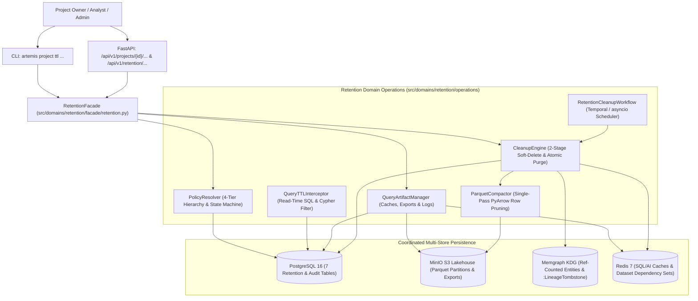
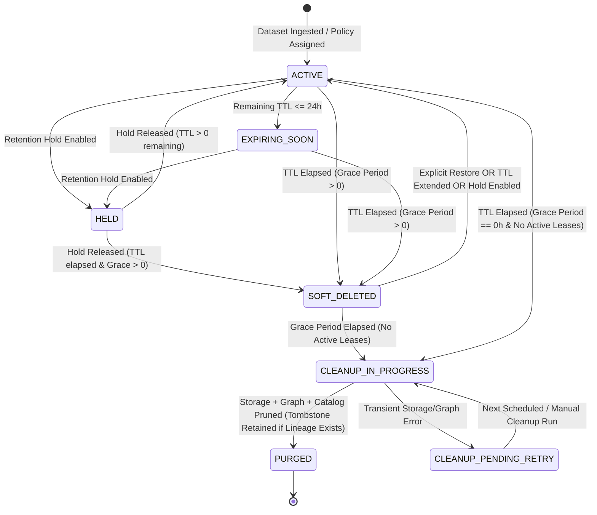

# Dataset & Query Data TTL Retention and Automated Cleanup Guide

**Feature**: `009-dataset-ttl-cleanup`  
**Domain**: `src/domains/retention/` (`RetentionFacade`)

---

## 1. Executive Summary & Architectural Overview

In data lakehouse platforms, raw telemetry, curated tables, knowledge graph entities, and analytical query caches accumulate continuously. Without automated lifecycle governance, storage footprint grows unbounded and stale data risks violating compliance or polluting analytical results.

The **Dataset & Query Data TTL Retention and Automated Cleanup** subsystem (`src/domains/retention/`) provides end-to-end data lifecycle governance across all four storage engines (**PostgreSQL**, **MinIO S3 Parquet**, **Memgraph**, and **Redis**) while adhering strictly to the platform's **Zero-JVM** and **< 12 GB idle RAM** constraints:

1. **4-Tier Policy Hierarchy**: Resolves TTL policies deterministically from `DATASET_EXPLICIT` $\rightarrow$ `TIER_DEFAULT` (`BRONZE=30d`, `SILVER=90d`, `GOLD=365d`) $\rightarrow$ `PROJECT_DEFAULT` $\rightarrow$ `PLATFORM_DEFAULT`.
2. **Configurable Expiration Granularity**:
   - **Per-File/Partition Ingestion Age (`INGESTION_AGE`)**: Overwriting a dataset (`--overwrite`) resets its TTL reference clock, whereas appending new batch files tracks `ingested_at` per partition (`dataset_partitions`) so older batch files expire on schedule without deleting newly appended files.
   - **Event-Timestamp Column Granularity (`TIMESTAMP_COLUMN`)**: Evaluates and prunes individual expired records/time-partitions using a designated timestamp column inside the dataset.
3. **Query Data Artifact Governance & Source-Aware Cache Invalidation**:
   - Governs 4 query artifact categories (`SQL_RESULT_CACHE`, `AI_RAG_CACHE`, `MATERIALIZED_EXPORT`, `QUERY_HISTORY_LOG`).
   - Ephemeral SQL and AI RAG caches are **immediately invalidated** whenever any underlying source dataset they depend on expires or is soft-deleted, while explicit materialized query exports (`--export-dataset`) and query audit logs follow their own assigned TTL independently.
4. **Transparent Read-Time Query Interception**:
   - `QueryTTLInterceptor` intercepts raw DuckDB SQL and Memgraph Cypher queries at read time, excluding expired or `SOFT_DELETED` files and injecting `TRY_CAST("<timestamp_column>" AS TIMESTAMPTZ) >= TIMESTAMPTZ '<cutoff_utc>'` subqueries so **0% of expired data is ever returned**, even before the background cleanup cycle runs.
5. **Two-Stage Soft-Delete, Single-Pass Parquet Compaction & Lineage Tombstones**:
   - Expired datasets first enter `SOFT_DELETED` state for a configurable grace period (default `24h`, or `0h` for immediate purge), supporting both explicit (`artemis project ttl restore`) and implicit (TTL extension or Retention Hold) restoration.
   - For partially expired `TIMESTAMP_COLUMN` Parquet files, rows are virtually soft-deleted at query time during the grace period and undergo a **single atomic PyArrow/DuckDB compaction** only after `TTL + grace_period` elapses.
   - Purging a dataset performs **reference-counted Memgraph entity pruning** (preserving shared entities referenced by other active datasets) and converts upstream `DataResource` nodes with downstream lineage into lightweight `:LineageTombstone` records.

---

## 2. Architecture & Multi-Store Cleanup Flow



---

## 3. Lifecycle State Machine



---

## 4. Relational & Graph Schema (`Feature 009`)

### 4.1 PostgreSQL Tables (`src/config/postgres_init.sql`)
- `ttl_policies`: Stores `PLATFORM`, `PROJECT`, `TIER`, `DATASET`, and `QUERY_DATA` retention rules (`ttl_expression`, `ttl_seconds`, `granularity`, `timestamp_column`, `grace_period_expression`).
- `dataset_retention_states`: Tracks effective policy source, `reference_timestamp`, `expires_at`, `soft_deleted_at`, `purge_after`, `retention_hold`, and `lifecycle_status`.
- `dataset_partitions`: Tracks per-file `ingested_at`, `min_event_ts`, `max_event_ts`, `size_bytes`, `record_count`, and `lifecycle_status`.
- `query_data_artifacts`: Tracks `SQL_RESULT_CACHE`, `AI_RAG_CACHE`, `MATERIALIZED_EXPORT`, and `QUERY_HISTORY_LOG` artifacts and their `source_datasets` dependencies.
- `dataset_active_leases`: Time-bounded concurrency locks (`INGESTION`, `PIPELINE_RUN`, `ANALYTICAL_QUERY`) ensuring active readers/writers are skipped during background cleanup (`skipped_locked_count`).
- `cleanup_job_runs`: Immutable audit log for `SCHEDULED`, `MANUAL`, and `DRY_RUN` cleanup executions.
- `lineage_tombstones`: Relational catalog record of purged upstream datasets that have surviving downstream derived datasets.

### 4.2 Memgraph Reference-Counted Pruning & `:LineageTombstone`
When `CleanupEngine` permanently purges an expired dataset:
1. All `(:DataAttribute)` nodes and `[:CONTAINS_ENTITY]` edges owned by that `(:DataResource)` are removed.
2. Orphaned `(:GenericEntity)` nodes in the project with **zero remaining incoming `[:CONTAINS_ENTITY]` edges** are pruned (`DETACH DELETE`), while shared entities referenced by other active datasets remain intact.
3. If the dataset participates in a `[:DERIVED_FROM]` lineage chain, the `(:DataResource)` node is converted in-place to carry `:LineageTombstone` (`lifecycle_status = 'PURGED'`, `location_uri = null`, `record_count = 0`), keeping downstream provenance trees unbroken.

---

## 5. CLI & REST API Reference

### 5.1 CLI Commands (`artemis project ttl`)

```bash
# 1. Configure dataset TTL (ingestion age or event-timestamp column granularity)
artemis project ttl set --project alpha-corp --dataset system_stats --tier bronze --ttl 30d
artemis project ttl set --project alpha-corp --dataset system_stats --tier bronze --ttl 7d \
  --granularity TIMESTAMP_COLUMN --timestamp-column event_ts --grace-period 24h

# 2. Inspect dataset retention state or clear explicit override
artemis project ttl get --project alpha-corp --dataset system_stats --tier bronze --json
artemis project ttl clear --project alpha-corp --dataset system_stats --tier bronze

# 3. Set project, tier, or query-data default TTLs
artemis project ttl set-default --project alpha-corp --scope TIER --tier BRONZE --ttl 14d
artemis project ttl set-default --project alpha-corp --scope QUERY_DATA --artifact-type MATERIALIZED_EXPORT --ttl 14d

# 4. Place/release investigative Retention Holds and restore SOFT_DELETED datasets
artemis project ttl hold --project alpha-corp --dataset system_stats --reason "Incident INC-991"
artemis project ttl unhold --project alpha-corp --dataset system_stats
artemis project ttl restore --project alpha-corp --dataset system_stats --ttl 60d

# 5. View project retention dashboard, run --dry-run preview, execute live cleanup, and inspect audit history
artemis project ttl summary --project alpha-corp
artemis project ttl cleanup --project alpha-corp --dry-run --json
artemis project ttl cleanup --project alpha-corp
artemis project ttl history --project alpha-corp --limit 20
```

### 5.2 REST API Endpoints

| Method & Endpoint | Permission | Description |
| :--- | :--- | :--- |
| `PUT /api/v1/projects/{project_id}/datasets/{dataset_id}/ttl` | Owner / Admin | Set or update dataset TTL policy (auto-restores if `SOFT_DELETED` and extended). |
| `GET /api/v1/projects/{project_id}/datasets/{dataset_id}/ttl` | Member | Inspect effective TTL policy, partition count, and expiration boundary. |
| `DELETE /api/v1/projects/{project_id}/datasets/{dataset_id}/ttl` | Owner / Admin | Remove dataset TTL override and revert to tier/project default. |
| `PUT /api/v1/projects/{project_id}/ttl/defaults` | Owner / Admin | Configure project, Medallion tier, or query artifact default TTL policies. |
| `PUT /api/v1/projects/{project_id}/datasets/{dataset_id}/hold` | Owner / Admin | Toggle Retention Hold on a specific dataset. |
| `PUT /api/v1/projects/{project_id}/ttl/hold` | Owner / Admin | Toggle Retention Hold across all datasets in a project. |
| `POST /api/v1/projects/{project_id}/datasets/{dataset_id}/ttl/restore` | Owner / Admin | Explicitly restore a `SOFT_DELETED` dataset or query export during its grace period. |
| `GET /api/v1/projects/{project_id}/ttl/summary` | Member | Retrieve project retention dashboard summary and expiring-soon counts. |
| `POST /api/v1/projects/{project_id}/ttl/cleanup` | Member (`dry_run`) / Owner (live) | Trigger on-demand project cleanup or deterministic `--dry-run` preview. |
| `GET /api/v1/projects/{project_id}/ttl/cleanup/runs` | Member | List historical `CleanupJobRun` audit records for a project. |
| `POST /api/v1/retention/cleanup` | Admin | Trigger global cleanup or dry-run sweep across all projects. |
| `GET /api/v1/retention/cleanup/runs` | Admin | List global historical cleanup execution runs. |
