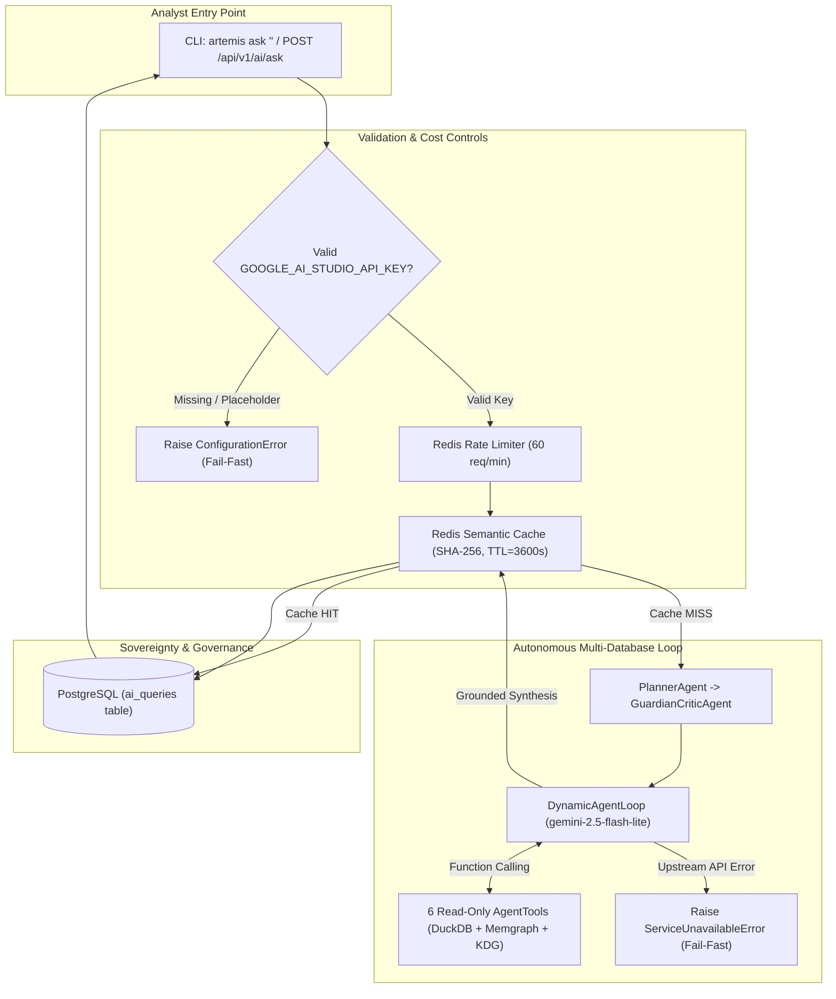

# Google AI Studio Integration & Fail-Fast Architecture Guide

This document explains why and how **Google AI Studio** (`gemini-2.5-flash-lite`) is integrated into **Poor Man's Defense Lakehouse**, how multi-database tool calling and Graph RAG augmentation work, how fail-fast production exceptions operate (`Feature 006`), and how offline automated tests achieve 100% pass rates using isolated test doubles.

---

## 1. Architectural Justification: Why Google AI Studio?

The primary constraint of the "Poor-Man's" architecture is running enterprise-grade big-data analytics, a universal Knowledge Discovery Graph, and cyber intelligence on a **single commodity Linux VM (16–32 GB RAM, 4–8 vCPUs, CPU-only, zero GPU)**.

### Local LLM (Ollama / vLLM) vs. Cloud API (Google AI Studio)

| Metric | Local LLM (e.g., Llama-3-8B via Ollama) | Google AI Studio (`gemini-2.5-flash-lite`) |
| :--- | :--- | :--- |
| **RAM Footprint** | **8 GB – 16 GB dedicated** (risks OOM kills of MinIO/Memgraph) | **< 20 MB** (lightweight `google-genai` HTTP client) |
| **CPU Utilization** | **100% across all cores** during generation (starves DuckDB/MQTT) | **0% local CPU load** during token synthesis |
| **Inference Latency** | **15 – 45 seconds** (CPU-only token generation) | **600ms – 1.5 seconds** |
| **Function Calling** | Brittle on small quantized CPU models | **Native multi-turn 6-tool Function Calling** |
| **Context Window** | 8k – 32k tokens | **1,000,000+ tokens** |

By offloading LLM token generation to Google AI Studio while keeping all raw data, Parquet analytics, and property graphs strictly local in MinIO, DuckDB, and Memgraph, the entire Artemis stack runs within **~2.5–3.2 GB of idle RAM**.

---

## 2. Production Execution & Fail-Fast Integrity (`Feature 006`)



### 2.1 Fail-Fast Initialization (`ConfigurationError`)
In [`src/domains/ai/operations/dynamic_loop.py`](src/domains/ai/operations/dynamic_loop.py) and [`src/services/ai/genai_service.py`](src/services/ai/genai_service.py), production initialization strictly verifies that a real API key is configured:

```python
is_placeholder_key = not self.api_key or "your_google_ai_studio_api_key_here" in self.api_key
if is_placeholder_key:
    raise ConfigurationError(
        "Google AI Studio API key is missing or set to placeholder value.",
        key="google_api_key",
    )
```

> [!IMPORTANT]
> Following `Feature 006` (`006-remove-production-mocks`), production services **never** silently fall back to simulated heuristics or fake responses when `GOOGLE_AI_STUDIO_API_KEY` is missing or when upstream inference fails. Any runtime failure raises `ServiceUnavailableError(service="gemini")`.

---

## 3. How Automated Tests Run Offline (`tests/fixtures/mocks/`)

Unit and integration test suites must execute deterministically offline without consuming paid API tokens or requiring live cloud connectivity. Artemis achieves this through **constructor dependency injection** and **isolated test doubles**:

- **Production Constructor Support**: `DynamicAgentLoop(client=...)` and `GenAIService(client=...)` accept an injected client instance.
- **Test Double Implementation**: [`tests/fixtures/mocks/mock_genai.py`](tests/fixtures/mocks/mock_genai.py) implements `MockGenAIClient`, which simulates multi-turn Gemini Function Calling (`query_analytics`, `query_graph`, `discover_workspace_schema`, `find_cross_project_entities`, `get_data_lineage`) and grounded text synthesis exclusively inside the test harness.
- **Pytest Fixture Wiring**: [`tests/conftest.py`](tests/conftest.py) automatically injects `MockGenAIClient`, `MockMemgraphClient`, `MockQueryCache`, and `MockAuditLogger` during test runs.

---

## 4. Configuring Live Google AI Studio Credentials

### Step 1: Obtain an API Key
1. Visit [Google AI Studio](https://aistudio.google.com/).
2. Click **Get API key** and create a key.

### Step 2: Configure `.env`
Update `/path/to/poor-mans-defense-lakehouse/.env`:
```env
GOOGLE_AI_STUDIO_API_KEY=AIzaSy...YourActualKeyHere...
GEMINI_MODEL=gemini-2.5-flash-lite
```

### Step 3: Execute Live Queries
```bash
artemis ask "What are the common IP addresses associated with recent anomalies?"
artemis ask "Which projects reference account ACCT-99812?" --json
```
