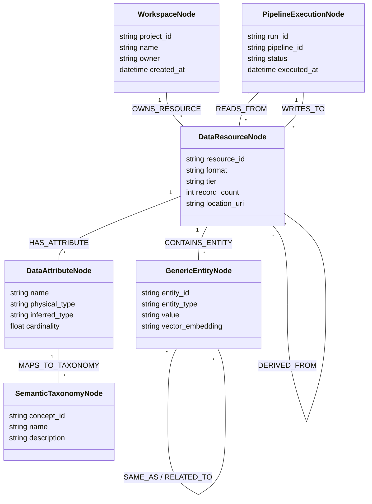

# Building a Universal, Domain-Agnostic Knowledge Discovery Graph (KDG)

## 1. Executive Summary & Core Philosophy

In big-data and enterprise analytics platforms like **Poor Man's Defense Lakehouse**, data resides in arbitrary formats—tabular Parquet files in MinIO (Bronze/Silver/Gold tiers), semi-structured JSON payloads, unstructured text documents, multi-modal media metadata, and property graph networks.

When workspaces are isolated into distinct project sandboxes, analysts face critical data discovery challenges:
1. **Intra-Project Asset Discovery**: Understanding what datasets, schemas, transformations, and domain entities exist within a single project sandbox without prior manual cataloging.
2. **Cross-Project Federated Discovery**: Uncovering hidden correlations, shared real-world entities (e.g., customer IDs, transaction hashes, device serials, patient identifiers), duplicate schemas, and data lineage *across all* projects without violating tenant security boundaries.

To support **any arbitrary data type** (finance, healthcare, IoT telemetry, logistics, threat intelligence, legal documents), this architecture defines a **Universal Domain-Agnostic Knowledge Discovery Graph (KDG)**. The KDG functions as a **federated semantic meta-layer** overlaid across physical lakehouse storage (DuckDB / MinIO), property graph engines (Memgraph), and relational metadata catalogs (PostgreSQL).

---

## 2. Technical Deep-Dive & Architectural Questions

### 2.1 Metadata Catalog vs. Universal Knowledge Discovery Graph

*Is this simply adding a standard metadata catalog (e.g., AWS Glue, Hive Metastore) to the system?*

No. A standard **metadata catalog** stores static structural definitions (database names, table names, column data types, file locations). A **Universal Knowledge Discovery Graph** creates an **active, dynamic semantic graph**:

1. **Active Semantic Overlay vs. Static Catalog**:
   - A metadata catalog only records that column `cust_id` is a `VARCHAR` in `Table A`.
   - The KDG extracts the underlying values, links `cust_id` to extracted **Generic Entities** (`Entity:Customer`), connects `cust_id` to **Universal Semantic Taxonomies** (`Concept:PersonIdentifier`), and maps its execution lineage (`TransformationLineage`).
2. **Multi-Hop Graph Traversals Across Projects**:
   - Instead of complex SQL `JOIN`s across disconnected metadata tables, openCypher graph traversals evaluate multi-hop relationships across arbitrary project workspaces in sub-milliseconds:
     $$\text{(Project A)} \rightarrow \text{(DataResource A)} \rightarrow \text{(GenericEntity: X)} \xrightarrow{\text{SAME\_AS}} \text{(GenericEntity: X)} \leftarrow \text{(DataResource B)} \leftarrow \text{(Project B)}$$
3. **Cross-Domain Data Convergence**:
   - Bridges tabular data (DuckDB/Parquet), unstructured text (LLM NER), semi-structured payloads (JSON/XML), and property graph nodes into a unified knowledge representation.

---

### 2.2 Can Scenarios 1 & 2 be done using `artemis ask` today?

*Can single-project data discovery and cross-project entity correlation be executed using `artemis ask` today?*

| Feature / Capability | What `artemis ask` Does Today | Why Single & Cross-Project Discovery Fails Today | How Universal KDG Solves It |
| :--- | :--- | :--- | :--- |
| **Intra-Project Schema & Asset Discovery** | Can run DuckDB SQL over explicit, known Parquet paths (`s3://telemetry/projects/alpha/...`). | **No Ingestion Schema Index**: Files ingested into a project today do not extract or index schemas or entities into Memgraph or PostgreSQL. Asking `artemis ask "What datasets and columns exist in alpha-corp?"` fails because no structural index exists. | Ingestion automatically introspects data structures (tabular, text, JSON) and creates `Project`, `DataResource`, and `DataAttribute` graph nodes. |
| **Cross-Project Entity Correlation** | Can run graph queries on manually created graph nodes or OSINT exports in Memgraph. | **1. Path Confinement Guardrails**: `ProjectQueryExecutor` strictly blocks cross-project DuckDB queries (`s3://telemetry/projects/*`).<br>**2. No Cross-Project Entity Index**: Memgraph does not index which project datasets contain matching entities across boundaries. | Ingestion extracts unique entities (`GenericEntity`) into Memgraph tagged with `project_id`. Memgraph links identical entities across projects via `SAME_AS` edges. Discovery happens at the metadata/graph layer without breaching DuckDB S3 path confinement! |

---

### 2.3 Critical Feasibility Analysis: Will a Domain-Agnostic Graph Work for ANY Data Type?

*Can entity extraction and knowledge graph construction truly work for ANY arbitrary data type without domain-specific rules?*

**YES — when implemented using a 4-Tier Hybrid Discovery Pipeline:**

```
                  +-----------------------------------+
                  |      ARBITRARY DATA INGESTION     |
                  +-----------------------------------+
                                    |
            +-----------------------+-----------------------+
            |                       |                       |
            v                       v                       v
  +-------------------+   +--------------------+   +--------------------+
  | Tier 1: Structural|   | Tier 2: Statistical|   | Tier 3: Open-Domain|
  |  Introspection    |   |  Type Profiling    |   | Zero-Shot LLM NER  |
  +-------------------+   +--------------------+   +--------------------+
            |                       |                       |
            +-----------------------+-----------------------+
                                    |
                                    v
                  +-----------------------------------+
                  | Tier 4: Dense Vector Semantic     |
                  | Similarity & Entity Resolution    |
                  +-----------------------------------+
                                    |
                                    v
                  +-----------------------------------+
                  | Memgraph Universal KDG Storage    |
                  +-----------------------------------+
```

#### How the 4 Tiers Process Arbitrary Data Types

1. **Tier 1: Structural Introspection (Deterministic Engine)**:
   - **Tabular/Columnar (Parquet, CSV, SQL)**: DuckDB inspects column headers, data types (`INTEGER`, `VARCHAR`, `TIMESTAMP`), null ratios, and cardinality.
   - **Semi-Structured (JSON, XML, YAML)**: JSON schema reflection flattens nested key-value pairs into `DataAttribute` hierarchies.
   - **Graph Payloads (JSON-LD, Cypher, GEXF)**: Direct graph node/edge reflection.
2. **Tier 2: Universal Statistical & Pattern Profiling**:
   - Universal pattern matchers identify common standard primitives regardless of domain:
     - Identifiers (UUIDs, GUIDs, hashes, auto-increment keys).
     - Spatial/Temporal (ISO-8601 datetimes, UNIX timestamps, WKT geometries, lat/long coordinates).
     - Network & Communication (IP addresses, URLs, email addresses, phone numbers).
3. **Tier 3: Open-Domain Zero-Shot LLM Extraction (For Unstructured & Ambiguous Data)**:
   - For unstructured text documents (PDFs, Markdown, logs) or ambiguous column names (`col_1`, `field_x`), Gemini (`gemini-2.5-flash`) performs **open-vocabulary zero-shot Named Entity Recognition (NER)** using a general prompt:
     > *"Extract key entities (Organizations, People, Products, Locations, Concepts, Identifiers) and their relationships from the input data."*
4. **Tier 4: Dense Vector Semantic Similarity & Entity Resolution (Embedding Layer)**:
   - Generates 768-dimensional vector embeddings for column names, dataset descriptions, and extracted entity values.
   - Column attributes with high cosine similarity (e.g., `client_number` vs `customer_id`) automatically map to the same `SemanticTaxonomy` concept.
   - Exact or fuzzy-matched entity values across projects are connected via `SAME_AS` edges using Union-Find cluster algorithms.

---

## 3. Universal Knowledge Discovery Graph Ontology Model

The KDG uses a generic, domain-agnostic property graph ontology implemented in Memgraph:



### Generic Node Definitions

1. **`Workspace`**: Isolated tenant workspace (`project_id`).
2. **`DataResource`**: Physical dataset, file, stream, or document payload in Bronze/Silver/Gold storage.
3. **`DataAttribute`**: Column, JSON key, or field attribute within a data resource.
4. **`GenericEntity`**: Extracted real-world or domain-specific entity value (`entity_type` = `Person`, `Organization`, `Location`, `Device`, `Identifier`, `Code`).
5. **`SemanticTaxonomy`**: Enterprise concept tag unifying attributes across datasets (e.g., `Taxonomy:UniqueIdentifier`).
6. **`PipelineExecution`**: Provenance node capturing pipeline transforms.

### Generic Edge Definitions

| Relationship Type | Source $\rightarrow$ Target | Description |
| :--- | :--- | :--- |
| `OWNS_RESOURCE` | `Workspace` $\rightarrow$ `DataResource` | Resource ownership. |
| `HAS_ATTRIBUTE` | `DataResource` $\rightarrow$ `DataAttribute` | Schema field containment. |
| `MAPS_TO_TAXONOMY` | `DataAttribute` $\rightarrow$ `SemanticTaxonomy` | Semantic classification edge. |
| `CONTAINS_ENTITY` | `DataResource` $\rightarrow$ `GenericEntity` | Link between dataset and extracted entity values. |
| `SAME_AS` | `GenericEntity` $\rightarrow$ `GenericEntity` | Cross-project entity deduplication link. |
| `DERIVED_FROM` | `DataResource` $\rightarrow$ `DataResource` | Cross-project and intra-project data lineage. |
| `PROCESSED_BY` | `DataResource` $\rightarrow$ `PipelineExecution` | Pipeline processing provenance. |

---

## 4. Graph Construction Algorithms, AI Usage & Universal Pipeline

### 4.1 Hybrid 2-Phase Construction Pipeline

```
[ Data Ingestion Trigger (Any Data Kind) ]
                   |
                   v
+-------------------------------------------------------------------+
| PHASE 1: Deterministic Sub-Second Extraction                     |
| - Parquet/CSV/SQL: DuckDB native C++ schema & stats inspection    |
| - JSON/XML: Structural key hierarchy flattening                   |
| - Regex/Primitives: Standard pattern matching (UUID, ISO date, IP)|
| - Memgraph Cypher: Atomic MERGE of Workspace, Resource, Attribute |
+-------------------------------------------------------------------+
                   |
                   v
+-------------------------------------------------------------------+
| PHASE 2: Asynchronous AI & Vector Enrichment Pipeline             |
| - Text/Unstructured: Gemini Zero-Shot Open-Domain NER             |
| - Ambiguous Schema: Vector embedding cosine similarity            |
| - Cross-Project Disjoint-Set: Union-Find for SAME_AS linking      |
+-------------------------------------------------------------------+
```

### 4.2 Algorithms Employed

1. **DuckDB Native Introspection**: C++ columnar inspection for fast schema extraction.
2. **Dense Vector Cosine Similarity**: Embeddings generated for attribute names/descriptions to cluster similar fields.
3. **Union-Find / Disjoint-Set Algorithm**: Merges identical `GenericEntity` nodes across project workspaces into canonical global entities connected via `SAME_AS`.
4. **Jaro-Winkler / Levenshtein Distance**: Fuzzy string matching for typo-tolerant entity resolution.
5. **Louvain Community Detection & PageRank**: Identifies high-centrality entity clusters and community subgraphs across datasets.

### 4.3 Targeted Role of AI

- **AI IS Used For**:
  - **Zero-Shot NER on Unstructured Text**: Extracting entities from free-form text, PDFs, and log files.
  - **Ambiguous Attribute Mapping**: Mapping non-obvious column names (`attr_01`) to canonical taxonomy concepts using sample data context.
- **AI IS NOT Used For**:
  - Structural schema extraction (Parquet/CSV) uses **deterministic C++ DuckDB code**.
  - Primitive pattern matching (dates, UUIDs, IPs) uses **regex and set logic** to ensure 100% precision with zero hallucination.

### 4.4 Universal Pipeline Framework

The pipeline uses a **Universal Wrapper + Modular Extractor** architecture:

```
                          +-------------------------------+
                          |   Universal Event Listener    |
                          |  DATASET_INGESTED(project, URI) |
                          +-------------------------------+
                                          |
        +---------------------------------+---------------------------------+
        |                                 |                                 |
        v                                 v                                 v
+-----------------------+     +-----------------------+     +-----------------------+
| Tabular Extractor     |     | JSON/Semi-Struct      |     | Unstructured Text     |
| (DuckDB C++ Parser)   |     | Extractor             |     | Extractor (LLM NER)   |
+-----------------------+     +-----------------------+     +-----------------------+
        |                                 |                                 |
        +---------------------------------+---------------------------------+
                                          |
                                          v
                          +-------------------------------+
                          |    Universal KDG Indexer      |
                          |   (Memgraph openCypher Engine)|
                          +-------------------------------+
```

---

## 5. System Design Changes & Component Architecture

To facilitate universal knowledge discovery, 5 platform components require updates:

```
+-------------------------------------------------------------------------------+
|                            SYSTEM DESIGN CHANGES                              |
+-------------------------------------------------------------------------------+
| 1. Ingestion Pipeline Hook: Asynchronous KDG Indexer Listener                 |
| 2. Memgraph Multi-Scope Cypher Indexes & Vector Search                         |
| 3. Global Discovery Facade (`DiscoveryFacade` in src/domains/discovery/)      |
| 4. AI Agent Extensions: Generic KDG Tools in `DynamicAgentLoop`               |
| 5. CLI & REST API: artemis project discover & artemis discover entity         |
+-------------------------------------------------------------------------------+
```

### 5.1 Cypher Indexing Strategy for Memgraph

```cypher
-- Single-workspace scoped indexes
CREATE INDEX ON :DataResource(project_id);
CREATE INDEX ON :GenericEntity(project_id);
CREATE INDEX ON :DataAttribute(project_id);

-- Global cross-workspace discovery indexes
CREATE INDEX ON :GenericEntity(value);
CREATE INDEX ON :GenericEntity(entity_type);
CREATE INDEX ON :SemanticTaxonomy(name);
```

### 5.2 AI Agent Tool Extensions (`AIFacade` & `DynamicAgentLoop`)

The AI reasoning loop is enhanced with 3 domain-agnostic discovery tools:

1. **`discover_workspace_schema`**: Returns all datasets, attributes, and extracted entity types inside a given project workspace.
2. **`find_cross_project_entities`**: Searches for occurrences of any entity value or type across all workspace boundaries.
3. **`get_data_lineage`**: Traverses `DERIVED_FROM` and `PROCESSED_BY` edges to construct data provenance trees.

---

## 6. Multi-Domain Usage Scenarios & CLI Examples

### Scenario 1: Healthcare / Clinical Data Discovery
Discovering patient data assets within a clinical research workspace:

```bash
# Discover knowledge assets within project clinical-trials-2026
artemis project discover clinical-trials-2026

# Output:
# === Knowledge Summary: clinical-trials-2026 ===
# Data Resources (2):
#   - patient_vitals (BRONZE, Parquet, 50,000 rows)
#       Attributes: subject_id (VARCHAR -> Taxonomy:PatientIdentifier), blood_pressure (INT)
#       Extracted Entities: 1,200 Patient IDs, 4 Hospital Codes
#   - trial_results (GOLD, Parquet, 1,200 rows)
#       Derived From: patient_vitals
```

### Scenario 2: Cross-Project Financial Fraud Discovery
Searching for a cross-project transaction hash or account ID:

```bash
# Search for cross-project occurrences of account ID ACCT-99812
artemis discover entity --value "ACCT-99812"

# Output:
# === Cross-Project Entity Correlation: ACCT-99812 ===
# Matches Found Across 2 Workspaces:
#   1. Workspace: retail-banking | DataResource: transactions (BRONZE) | Field: src_account
#   2. Workspace: fraud-investigations | DataResource: flagged_accounts (GOLD) | Field: account_num
```

### Scenario 3: AI Natural Language Cross-Project Discovery

```bash
artemis ask "Which project workspaces contain datasets referencing customer accounts flagged for high risk?"
```

---

## 7. Implementation Blueprint & File Delta

| Component | Target Path | Changes Required |
| :--- | :--- | :--- |
| **Data Models** | `src/domains/discovery/models/` | Add Pydantic contracts (`WorkspaceKnowledgeContract`, `EntityCorrelationContract`, `LineageContract`). |
| **Memgraph Client** | `src/services/graph/memgraph_client.py` | Add Cypher procedures for universal KDG indexing (`index_resource_schema`, `link_generic_entities`). |
| **Ingestion Hook** | `src/domains/project/operations/scoped_ingestion.py` | Trigger asynchronous `UniversalKDGIndexer` during `ingest_tabular`, `ingest_graph`, and file uploads. |
| **Discovery Facade** | `src/domains/discovery/facade/discovery.py` | Implement unified facade for workspace-scoped and cross-project graph queries. |
| **AI Agent Tools** | `src/domains/ai/operations/tools.py` | Register `discover_workspace_schema`, `find_cross_project_entities`, and `get_data_lineage`. |
| **CLI Commands** | `src/cli/commands/discover.py` | Add `artemis project discover <id>` and `artemis discover entity --value <val>`. |
| **REST Router** | `src/domains/discovery/api/router.py` | Expose `/api/v1/discovery/workspace/{id}` and `/api/v1/discovery/cross-project`. |
| **Tests** | `tests/integration/test_knowledge_discovery.py` | Integration tests for multi-domain indexing, cross-project entity resolution, and AI discovery tools. |
