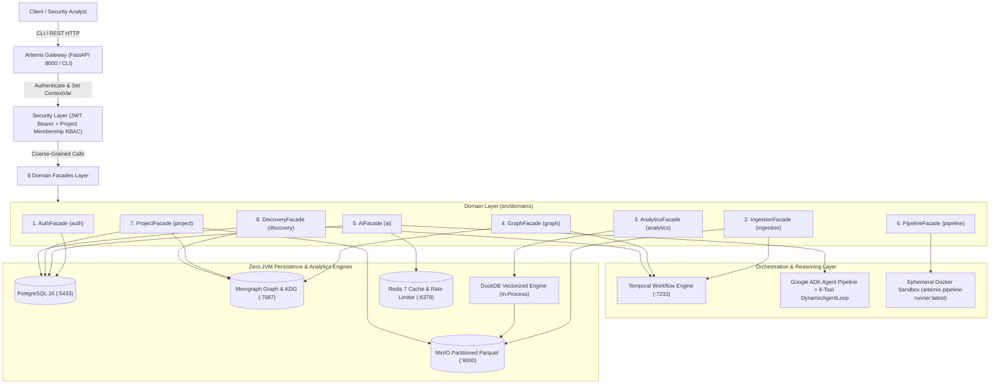
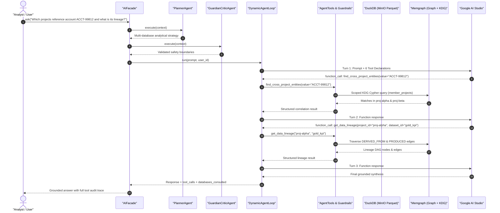

# Microservice Domain Architecture Guide

## Overview & Alignment with `uservice-template`

**Poor Man's Defense Lakehouse** implements a clean, modular, Domain-Driven Design (DDD) architecture aligned with the enterprise patterns established in [`uservice-template`](https://github.com/dotness/uservice-template). It combines strict hexagonal domain boundaries, asynchronous Temporal workflows, Google ADK 2.0 multi-agent reasoning, JWT + RBAC security, and a **zero-mock fail-fast production core** (`Feature 006`).

---

## 1. Hexagonal Domain Organization

Each business capability resides within [`src/domains/<domain>/`](src/domains) and is structured into 4 strict sub-packages:

| Sub-Package | Purpose | Key Responsibilities |
| :--- | :--- | :--- |
| `api/` | Transport Ingress | Standardized FastAPI router endpoints (`/api/v1/<domain>/*`). |
| `facade/` | Coarse-Grained Gateway | Encapsulates domain logic, resolves user context via `get_current_user()`, enforces transaction and membership boundaries. |
| `models/` | Data Contracts & Storage | Pydantic Contract DTOs (`contract/`) and storage schemas (`db/` or `storage/`). Internal database records are never leaked across domain boundaries. |
| `operations/` | Multi-Step Workflows | Composable `BaseStep` activities, AST validators, Docker runner sandboxes, KDG indexers, and Temporal workflows. |

### The 8 Core Domains

1. **`auth`** ([`src/domains/auth/`](src/domains/auth)): User identity verification, JWT Bearer token issuance (`/api/v1/auth/token`), and bcrypt password hashing.
2. **`ingestion`** ([`src/domains/ingestion/`](src/domains/ingestion)): High-frequency MQTT telemetry ingestion (`telemetry/#`), crash-resilient POSIX disk buffering (`/tmp/artemis/buffer/events.jsonl`), and Apache Arrow/Parquet compaction into MinIO.
3. **`analytics`** ([`src/domains/analytics/`](src/domains/analytics)): Embedded C++ DuckDB vectorized SQL execution directly over S3/MinIO Parquet partitions, plus `ProjectQueryExecutor` S3 prefix confinement guardrails.
4. **`graph`** ([`src/domains/graph/`](src/domains/graph)): Memgraph Bolt property graph client, node/edge management, and SpiderFoot OSINT reconnaissance import workflows.
5. **`ai`** ([`src/domains/ai/`](src/domains/ai)): Google ADK 2.0 multi-agent reasoning (`PlannerAgent` $\rightarrow$ `GuardianCriticAgent` $\rightarrow$ `ExecutorAgent`), `DynamicAgentLoop` with 6 read-only tools across DuckDB, Memgraph, and KDG, Redis semantic caching, and PostgreSQL audit logging.
6. **`pipeline`** ([`src/domains/pipeline/`](src/domains/pipeline)): System batch pipelines (`mqtt_to_minio`) and project-scoped Medallion transformation pipelines with Python AST syntax/security validation, immutable version increments, and rootless ephemeral Docker execution.
7. **`project`** ([`src/domains/project/`](src/domains/project)): Multi-tier isolated project workspaces (`BRONZE`, `SILVER`, `GOLD`), tabular/graph ingestion (`ScopedIngestionService`), and role-based project membership (`ProjectMembershipService` with `owner` and `member` roles).
8. **`discovery`** ([`src/domains/discovery/`](src/domains/discovery)): Universal Domain-Agnostic Knowledge Discovery Graph (KDG) overlay in Memgraph, 2-phase indexing (`StructuralIndexer`, `PatternProfiler`, `KDGEnrichmentWorkflow`), `Rapidfuzz` + Disjoint-Set Union (`DSU`) entity resolution, and dataset provenance/lineage tracking.

---

## 2. Complete REST API Surface (34 Endpoints)

The FastAPI gateway ([`src/api.py`](src/api.py)) mounts 9 routers across the 8 domains plus system health:

| Domain / Tag | Method & Path | Handler / Description |
| :--- | :--- | :--- |
| **System** | `GET /health` | Gateway readiness and version check (`0.2.0`). |
| **Auth** | `POST /api/v1/auth/token` | Authenticate credentials and issue signed HS256 JWT Bearer token. |
| **Ingestion** | `POST /api/v1/ingestion/event` | Ingest a single validated `TelemetryEvent` into the disk buffer. |
| **Ingestion** | `POST /api/v1/ingestion/flush` | Trigger atomic buffer rotation and Parquet flush to MinIO. |
| **Analytics** | `POST /api/v1/analytics/query` | Execute vectorized DuckDB SQL over `s3://telemetry/**/*.parquet`. |
| **Graph** | `POST /api/v1/graph/node` | Upsert an intelligence entity node into Memgraph. |
| **Graph** | `POST /api/v1/graph/edge` | Upsert a directed relationship edge into Memgraph. |
| **Graph** | `POST /api/v1/graph/import-osint` | Parse and import a SpiderFoot OSINT JSON export into Memgraph. |
| **Graph** | `GET /api/v1/graph/related` | Query 1-hop related entities and relationships by search term. |
| **AI** | `POST /api/v1/ai/ask` | Execute multi-agent ADK reasoning and 6-tool `DynamicAgentLoop` synthesis. |
| **Pipeline (System)** | `POST /api/v1/pipeline/run` | Execute a named system pipeline (e.g., `mqtt_to_minio`). |
| **Project** | `POST /api/v1/projects` | Create an isolated project workspace and assign creator as `owner`. |
| **Project** | `GET /api/v1/projects` | List all registered project workspaces. |
| **Project** | `GET /api/v1/projects/{project_id}` | Retrieve project metadata and status. |
| **Project** | `DELETE /api/v1/projects/{project_id}` | Delete project workspace and cascade clean associated assets. |
| **Project** | `POST /api/v1/projects/{project_id}/ingest/tabular` | Ingest CSV/JSON/Parquet into `BRONZE`/`SILVER`/`GOLD` + trigger KDG Phase 1 index. |
| **Project** | `POST /api/v1/projects/{project_id}/ingest/graph` | Ingest `project_id`-tagged nodes/edges into Memgraph + trigger KDG index. |
| **Project** | `GET /api/v1/projects/{project_id}/datasets` | List datasets registered across Medallion tiers in the project. |
| **Project** | `POST /api/v1/projects/{project_id}/query` | Execute DuckDB SQL strictly confined to `s3://telemetry/projects/{project_id}/*`. |
| **Project** | `GET /api/v1/projects/{project_id}/runs` | List historical pipeline execution runs for the project. |
| **Project Members** | `GET /api/v1/projects/{project_id}/members` | List project members and roles (`owner`, `member`). |
| **Project Members** | `POST /api/v1/projects/{project_id}/members` | Grant or update project membership (requires `owner` or `admin`). |
| **Project Members** | `DELETE /api/v1/projects/{project_id}/members/{user_id}` | Revoke project membership (enforces last-owner protection). |
| **Project Pipelines** | `POST /api/v1/projects/{project_id}/pipelines` | Validate Python AST and register a versioned transformation pipeline. |
| **Project Pipelines** | `GET /api/v1/projects/{project_id}/pipelines` | List all transformation pipelines in a project. |
| **Project Pipelines** | `GET /api/v1/projects/{project_id}/pipelines/{pipeline_id}` | Retrieve pipeline definition, stage, and script version. |
| **Project Pipelines** | `PUT /api/v1/projects/{project_id}/pipelines/{pipeline_id}` | Update pipeline script/stage and atomically increment `version`. |
| **Project Pipelines** | `DELETE /api/v1/projects/{project_id}/pipelines/{pipeline_id}` | Delete a project pipeline definition. |
| **Project Pipelines** | `POST /api/v1/projects/{project_id}/pipelines/{pipeline_id}/run` | Execute pipeline in ephemeral rootless Docker sandbox + record KDG lineage. |
| **Project Pipelines** | `GET /api/v1/projects/{project_id}/pipelines/{pipeline_id}/runs` | List execution runs for a specific pipeline. |
| **Discovery (KDG)** | `GET /api/v1/discovery/workspace/{project_id}` | Retrieve KDG structural summary, attributes, taxonomies, and entity counts. |
| **Discovery (KDG)** | `GET /api/v1/discovery/cross-project` | Correlate shared entities across authorized member projects (exact or `--fuzzy`). |
| **Discovery (KDG)** | `GET /api/v1/discovery/lineage/{project_id}/{dataset_id}` | Traverse upstream/downstream dataset derivations (`DERIVED_FROM`, `PRODUCED`). |
| **Discovery (KDG)** | `POST /api/v1/discovery/reindex/{project_id}` | Schedule an asynchronous KDG structural/enrichment re-index job (`202 Accepted`). |
| **Discovery (KDG)** | `GET /api/v1/discovery/jobs/{project_id}` | List KDG indexing jobs and their phase/status (`pending`, `running`, `completed`). |

---

## 3. Authentication, RBAC & Zero-Trust Confinement

1. **JWT Bearer Authentication** ([`src/security/jwt.py`](src/security/jwt.py), [`src/security/middleware.py`](src/security/middleware.py)):
   - Analysts authenticate via `artemis login -u <user> -p <pass>`, caching a signed JWT token in `~/.artemis/token` with `0600` POSIX permissions (`artemis whoami` inspects active session status).
   - FastAPI requests are verified by `authenticate_user`, which populates `ContextVar[current_user]`.
   - Public endpoints exempted from Bearer auth: `/health`, `/api/v1/auth/token`, `/docs`, `/openapi.json`.
2. **Project Membership RBAC** ([`src/domains/project/operations/membership.py`](src/domains/project/operations/membership.py)):
   - Every project enforces an explicit membership roster in PostgreSQL (`project_members`) with roles `owner` and `member` (plus system `admin` bypass).
   - Non-member projects return `None` / `404 Not Found` and are parameterized out of all Cypher queries (`n.project_id IN $member_projects`), guaranteeing **0% existence or metadata leakage**.

---

## 4. Temporal Workflow Engine & Durable Operations

Batch and asynchronous enrichment workflows are structured around Temporal ([`src/base/temporal.py`](src/base/temporal.py)):

- **`FlushBufferWorkflow`** ([`src/domains/ingestion/operations/flush.py`](src/domains/ingestion/operations/flush.py)):
  - `RotateBufferStep` $\rightarrow$ `ConvertToParquetStep` $\rightarrow$ `UploadToMinioStep`.
- **`OsintImportWorkflow`** ([`src/domains/graph/operations/import_osint.py`](src/domains/graph/operations/import_osint.py)):
  - `ParseSpiderfootStep` $\rightarrow$ `ImportToMemgraphStep`.
- **`KDGEnrichmentWorkflow`** ([`src/domains/discovery/operations/enrichment_workflow.py`](src/domains/discovery/operations/enrichment_workflow.py)):
  - Asynchronous Phase 2 KDG semantic taxonomy mapping, unstructured text NER extraction, and cross-project `SAME_AS` entity resolution.

---

## 5. Google ADK 2.0 & 6-Tool Autonomous Agent Loop

Intelligence and discovery queries executed via `AIFacade.ask` pass through a three-stage agent pipeline ([`src/domains/ai/operations/ai_agents.py`](src/domains/ai/operations/ai_agents.py)) and a multi-turn function-calling loop ([`src/domains/ai/operations/dynamic_loop.py`](src/domains/ai/operations/dynamic_loop.py)):

1. **`PlannerAgent`**: Deconstructs the analyst's natural language inquiry into a structured multi-database strategy.
2. **`GuardianCriticAgent`**: Verifies safety bounds and blocks destructive or out-of-scope intentions.
3. **`ExecutorAgent` & `DynamicAgentLoop`**: Grants `gemini-2.5-flash-lite` access to **6 read-only tools** ([`src/domains/ai/operations/tools.py`](src/domains/ai/operations/tools.py)):
   - `query_analytics(sql_query)`: Vectorized DuckDB SQL over MinIO Parquet files.
   - `query_graph(cypher_query)`: OpenCypher traversal over Memgraph threat intelligence nodes.
   - `get_schema_info(target)`: Schema introspection for `analytics`, `graph`, or `all`.
   - `discover_workspace_schema(project_id)`: Intra-project KDG summary (datasets, columns, semantic taxonomies, entity counts).
   - `find_cross_project_entities(value, entity_type, fuzzy)`: Cross-project KDG entity correlation scoped to caller membership.
   - `get_data_lineage(project_id, dataset_id, depth)`: Upstream/downstream provenance graph traversal.

---

## 6. Clean Production Architecture & Fail-Fast Exceptions (`Feature 006`)

All production classes in `src/` contain **zero embedded test mocks, zero fake in-memory fallback stores, and zero heuristic simulation loops**. When an external service or configuration is missing or unreachable in production, components fail fast with typed exceptions from [`src/core/exceptions.py`](src/core/exceptions.py):

- `ArtemisError`: Base exception for all platform errors.
- `ConfigurationError`: Raised immediately when required settings or API keys (e.g., `GOOGLE_AI_STUDIO_API_KEY`) are missing or set to placeholder values.
- `ConnectionError`: Raised when a required daemon (`Memgraph`, `PostgreSQL`, `Redis`, `MinIO`) fails a fast TCP socket pre-check or driver handshake.
- `ServiceUnavailableError`: Raised when an upstream runtime operation (`Gemini API`, `Docker daemon`, `Memgraph query`) fails during live execution.

For offline testing, reusable test doubles live exclusively in [`tests/fixtures/mocks/`](tests/fixtures/mocks) and are injected via dependency injection in [`tests/conftest.py`](tests/conftest.py). See [Clean Production Architecture & Testing Guide](clean_architecture_and_testing.md) for details.
