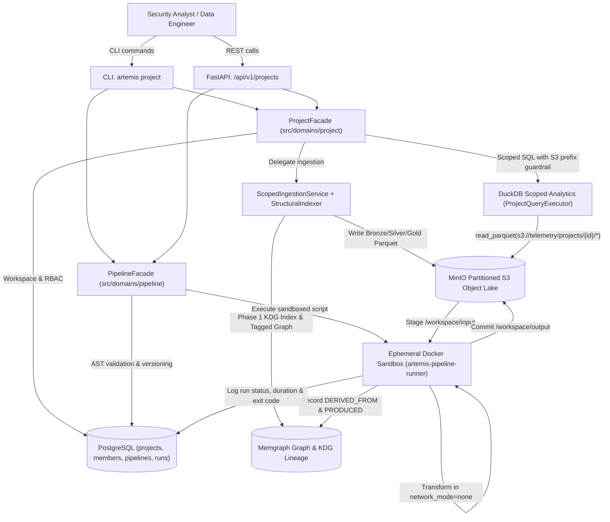

# Project Data Pipelines & Sandboxed Medallion Execution

This document details the architecture, security models, data contracts, and execution workflows for the **Project Data Pipelines** subsystem (`Feature 004` + `Feature 005` lineage integration) of the **Poor Man's Defense Lakehouse** platform.

---

## 1. Executive Summary & Architectural Motivation

In standard enterprise data architectures, multi-tenant workspace management, user-submitted script execution, and Medallion data engineering typically demand heavyweight distributed frameworks:
- **Apache Spark / Databricks** (JVM, multi-gigabyte heap overhead)
- **Apache Airflow / Celery** (heavyweight polling scheduler daemons)
- **Kubernetes / Pod Operators** (significant control-plane memory footprint)

Artemis.IA eliminates all JVM and cluster overhead by implementing **sovereign, single-VM project isolation** and **ephemeral rootless Docker container runners**:
- **Zero JVM overhead**: Keeps total platform idle memory footprint under **3.2 GB RAM** (well within the 12 GB budget on a 16–32 GB VM).
- **Ephemeral container sandboxing**: User scripts run in non-root, isolated, resource-bounded containers (`artemis-pipeline-runner:latest`) that terminate and clean up immediately upon completion.
- **Strict network isolation**: Scripts execute with `network_mode="none"`, preventing unauthorized external egress or data exfiltration.
- **Medallion tier progression**: Standardized transitions across `BRONZE` (raw landing), `SILVER` (cleansed/structured), and `GOLD` (aggregated/refined), automatically tracked in the **Knowledge Discovery Graph (KDG)**.

---

## 2. Architecture & Data Flow



---

## 3. Core Subsystems

### 3.1 Project Workspace Isolation, Membership & Medallion Tiers

Each project created in Artemis ([`src/domains/project/operations/project_manager.py`](src/domains/project/operations/project_manager.py)) represents a strictly isolated multi-tenant workspace:
- **Relational Catalog**: Tracked in PostgreSQL tables `projects`, `project_members`, `project_datasets`, `project_pipelines`, `project_pipeline_runs`, and `kdg_index_jobs`.
- **Role-Based Access Control (RBAC)**: Project creators are automatically registered as `owner` in `project_members`. Owners can grant or revoke `member` or `owner` access via `artemis project members add|remove`.
- **Object Lake Partitioning**: MinIO object paths are strictly namespaced:
  ```text
  s3://telemetry/projects/{project_id}/{tier}/{dataset_id}/year=YYYY/month=MM/day=DD/*.parquet
  ```
- **Medallion Tiers**:
  - `BRONZE`: Raw landing area for unmodified tabular imports (CSV, JSON Lines, Parquet).
  - `SILVER`: Cleansed, normalized, and schema-validated data generated by sandboxed pipeline runs.
  - `GOLD`: Business-level aggregations, feature vectors, or high-value anomaly tables.
- **Knowledge Graph Scoping**: All graph nodes, edges, and KDG metadata (`DataResource`, `DataAttribute`, `GenericEntity`) imported or created by a project are tagged with `{project_id: "<slug>"}`, preventing cross-project graph bleed.

### 3.2 Shareable Pipeline Entities & AST Script Validation

Pipelines ([`src/domains/pipeline/operations/pipeline_manager.py`](src/domains/pipeline/operations/pipeline_manager.py)) are versioned entities registered within a project:
- **AST-Level Syntax Validation**: Every uploaded Python script is inspected using [`ScriptValidator`](src/domains/pipeline/operations/script_validator.py) (`ast.parse()`) prior to database insertion. Malformed scripts with syntax errors or empty bodies are rejected immediately with line-numbered diagnostics.
- **Immutable Version History**: Any update to a pipeline's script via `PUT /api/v1/projects/{project_id}/pipelines/{pipeline_id}` or `artemis project pipeline update` atomically increments the integer `version` column while preserving historical execution records.
- **Execution Bindings**: Each pipeline binds to a processing stage: `INGESTION`, `BRONZE_TO_SILVER`, `SILVER_TO_GOLD`, or `CUSTOM`.

### 3.3 Ephemeral Docker Runner Sandbox

User-provided Python scripts execute inside an ephemeral, hardened container managed by [`DockerPipelineRunner`](src/domains/pipeline/operations/docker_runner.py):

| Security & Resource Control | Implementation | Purpose |
| :--- | :--- | :--- |
| **Resource Bounds** | `mem_limit="2g"`, `nano_cpus=2_000_000_000` (2 CPUs) | Prevents runaway scripts from starving platform services on the host VM. |
| **Network Isolation** | `network_mode="none"` | Blocks all incoming and outgoing network traffic during script execution. |
| **Non-Root Execution** | `user="artemis"` (UID/GID 10001 in `docker/pipeline-runner/Dockerfile`) | Restricts container process permissions. |
| **Ephemeral Lifecycle** | `container.remove(force=True)` in `finally` block | Container and temporary host staging directories are destroyed immediately upon completion. |
| **Execution Timeouts** | Configurable `timeout_seconds` (default 300s) | Automatically kills hung containers and records `status="TIMEOUT"`. |
| **Fail-Fast Daemon Check** | Raises `ServiceUnavailableError(service="docker")` | Fails explicitly if the Docker daemon or image is unavailable in production (`Feature 006`). |

#### Filesystem Execution Contract
User scripts interact with the container filesystem via a standardized contract:
- **Input Directory** (`/workspace/input/`): Mounted read-only (`mode="ro"`), containing source dataset Parquet/CSV files staged from MinIO.
- **Output Directory** (`/workspace/output/`): Mounted read-write (`mode="rw"`), where the script writes transformed `.parquet`, `.csv`, or `.json` artifacts.
- **Script Mount** (`/workspace/script.py`): Mounted read-only (`mode="ro"`).

Example user transformation script:
```python
import glob
import pandas as pd

# 1. Read from standardized read-only input directory
input_files = glob.glob("/workspace/input/*")
dfs = [pd.read_parquet(f) if f.endswith(".parquet") else pd.read_csv(f) for f in input_files]
df = pd.concat(dfs, ignore_index=True)

# 2. Perform domain transformations
df["is_high_cpu"] = df["value"] > 90.0
df["processed_by"] = "medallion_v1"

# 3. Write to standardized output directory
df.to_parquet("/workspace/output/cleaned_metrics.parquet", index=False)
```

Upon successful exit (`exit_code == 0`), [`PipelineExecutor`](src/domains/pipeline/operations/pipeline_executor.py) commits all output files in `/workspace/output/` to the target tier in MinIO, registers the new dataset in PostgreSQL, indexes its schema in the KDG, and records `DERIVED_FROM`, `CONSUMED`, and `PRODUCED` lineage edges in Memgraph via [`LineageService`](src/domains/discovery/operations/lineage.py).

### 3.4 Scoped Analytical Query Confinement

Analysts query project partitions using DuckDB SQL via [`ProjectQueryExecutor`](src/domains/analytics/operations/project_query.py). To prevent unauthorized cross-project data leakage:
- **Read-Only Guardrail**: Blocks mutating keywords (`DROP`, `DELETE`, `INSERT`, `UPDATE`, `ALTER`, `COPY`, `ATTACH`, `DETACH`).
- **S3 Prefix Confinement**: Inspects all `s3://` URIs in the SQL query. Every URI must begin with `s3://telemetry/projects/{project_id}/`. Queries referencing root `s3://telemetry/` or another project (`s3://telemetry/projects/other-proj/`) raise `PermissionError`.
- **Graceful Empty Partition Handling**: Queries against a valid project prefix that has no files yet return `{"columns": [], "rows": [], "row_count": 0, "empty": True}` without crashing.

---

## 4. CLI Reference

```bash
# 1. Create and inspect a project workspace
artemis project create --id alpha-ops --name "Alpha Operations" --desc "Medallion workspace"
artemis project list
artemis project info --id alpha-ops

# 2. Manage project members
artemis project members list alpha-ops
artemis project members add alpha-ops --user analyst_bob --role member

# 3. Ingest tabular and graph datasets
artemis project ingest --project alpha-ops --dataset raw_metrics --tier bronze --file ./sample.csv
artemis project ingest-graph --project alpha-ops --file ./threat_intel.json

# 4. Register, update, and run a sandboxed transformation pipeline
artemis project pipeline create \
  --project alpha-ops \
  --name filter_high_cpu \
  --stage BRONZE_TO_SILVER \
  --script ./scripts/clean_and_flag.py

artemis project pipeline list --project alpha-ops
artemis project pipeline get --project alpha-ops --id filter_high_cpu

artemis project pipeline run \
  --project alpha-ops \
  --name filter_high_cpu \
  --input-dataset raw_metrics \
  --target-dataset clean_anomalies \
  --target-tier silver

artemis project pipeline runs --project alpha-ops

# 5. Query project data and trace lineage
artemis project query --project alpha-ops \
  --sql "SELECT device_id, value, is_high_cpu FROM read_parquet('s3://telemetry/projects/alpha-ops/silver/clean_anomalies/**/*.parquet')"

artemis project discover alpha-ops
artemis discover lineage --project alpha-ops --dataset clean_anomalies
```
