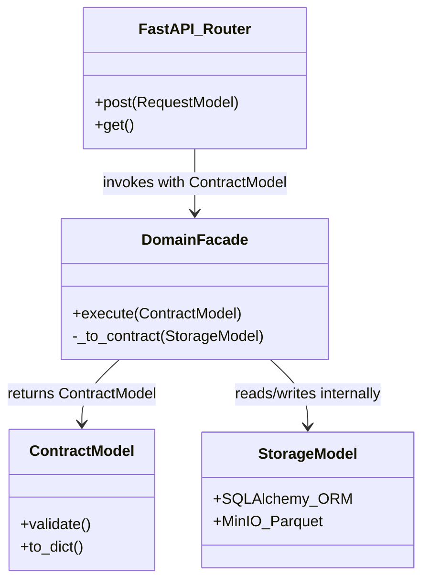

# Data Model Specification: Microservice Architecture Alignment

**Feature**: [002-uservice-alignment](specs/002-uservice-alignment/spec.md)  
**Date**: 2026-10-11  

This document defines the domain entities, Pydantic Contract models, and SQLAlchemy Storage models according to `uservice-template` standards.

---

## 1. Domain Entities & Contract Models (`models/contract/`)

Contract models are the canonical, immutable shape of domain data exchanged between layers (API $\leftrightarrow$ Facade $\leftrightarrow$ CLI).

### 1.1 Ingestion Domain (`src/domains/ingestion/models/contract/`)

```python
class TelemetryEventContract(BaseModel):
    event_id: str = Field(default_factory=lambda: str(uuid.uuid4()))
    timestamp: datetime = Field(default_factory=lambda: datetime.now(timezone.utc))
    device_id: str
    metric_name: str
    value: float
    unit: str
    metadata: Dict[str, Any] = Field(default_factory=dict)

class BatchFlushResultContract(BaseModel):
    status: str  # SUCCESS | FAILED
    events_processed: int
    object_key: Optional[str] = None
    details: Dict[str, Any] = Field(default_factory=dict)
```

### 1.2 Analytics Domain (`src/domains/analytics/models/contract/`)

```python
class QueryRequestContract(BaseModel):
    sql: str
    format: str = "table"  # table | json | csv

class QueryResultContract(BaseModel):
    columns: List[str]
    rows: List[List[Any]]
    row_count: int
    duration_ms: int
    formatted_output: Optional[str] = None
```

### 1.3 Graph Domain (`src/domains/graph/models/contract/`)

```python
class GraphNodeContract(BaseModel):
    name: str
    label: str  # IP_ADDRESS | DOMAIN_NAME | ANOMALY | THREAT_ACTOR
    confidence: float = 0.8
    properties: Dict[str, Any] = Field(default_factory=dict)

class GraphEdgeContract(BaseModel):
    source: str
    target: str
    relationship: str  # RESOLVES_TO | ASSOCIATED_WITH | SUBDOMAIN_OF
    properties: Dict[str, Any] = Field(default_factory=dict)

class OsintImportResultContract(BaseModel):
    nodes_imported: int
    edges_imported: int
    status: str
```

### 1.4 AI Domain (`src/domains/ai/models/contract/`)

```python
class AIQueryRequestContract(BaseModel):
    prompt: str
    user_id: str = "analyst"

class AIQueryResponseContract(BaseModel):
    query_id: str
    response: str
    model_used: str
    cached: bool
    duration_ms: int
    context: List[Dict[str, Any]] = Field(default_factory=list)
```

### 1.5 Auth Domain (`src/domains/auth/models/contract/`)

```python
class UserInfoContract(BaseModel):
    id: str
    username: str
    roles: List[str] = Field(default_factory=lambda: ["analyst"])
    scopes: List[str] = Field(default_factory=lambda: ["read", "write"])

class TokenResponseContract(BaseModel):
    access_token: str
    token_type: str = "Bearer"
    expires_in: int = 86400  # 24 hours
    user: UserInfoContract
```

---

## 2. Storage Models (`models/storage/`)

Storage models define persistence entities bound to PostgreSQL via SQLAlchemy 2.0.

### 2.1 User Storage Model (`src/domains/auth/models/storage/user.py`)

```python
class UserStorage(Base):
    __tablename__ = "users"

    id: Mapped[str] = mapped_column(String(64), primary_key=True)
    username: Mapped[str] = mapped_column(String(100), unique=True, nullable=False)
    password_hash: Mapped[str] = mapped_column(String(255), nullable=False)
    roles: Mapped[List[str]] = mapped_column(JSON, default=list)
    is_active: Mapped[bool] = mapped_column(Boolean, default=True)
    created_at: Mapped[datetime] = mapped_column(DateTime(timezone=True), default=datetime.utcnow)
```

### 2.2 Pipeline Storage Model (`src/domains/pipeline/models/storage/pipeline.py`)

```python
class PipelineStorage(Base):
    __tablename__ = "pipelines"

    pipeline_id: Mapped[str] = mapped_column(String(64), primary_key=True)
    name: Mapped[str] = mapped_column(String(100), unique=True, nullable=False)
    schedule: Mapped[Optional[str]] = mapped_column(String(50))
    status: Mapped[str] = mapped_column(String(20), default="ACTIVE")
    last_status: Mapped[Optional[str]] = mapped_column(String(20))
    last_run_at: Mapped[Optional[datetime]] = mapped_column(DateTime(timezone=True))
```

### 2.3 AI Query Audit Storage Model (`src/domains/ai/models/storage/audit.py`)

```python
class AIQueryStorage(Base):
    __tablename__ = "ai_queries"

    query_id: Mapped[str] = mapped_column(String(64), primary_key=True)
    user_id: Mapped[str] = mapped_column(String(64), nullable=False)
    prompt: Mapped[str] = mapped_column(Text, nullable=False)
    response: Mapped[str] = mapped_column(Text, nullable=False)
    model_used: Mapped[str] = mapped_column(String(64), nullable=False)
    cached: Mapped[bool] = mapped_column(Boolean, default=False)
    duration_ms: Mapped[int] = mapped_column(Integer, nullable=False)
    context_payload: Mapped[Optional[Dict[str, Any]]] = mapped_column(JSON)
    created_at: Mapped[datetime] = mapped_column(DateTime(timezone=True), default=datetime.utcnow)
```

---

## 3. Data Relationships & Layer Conversion


