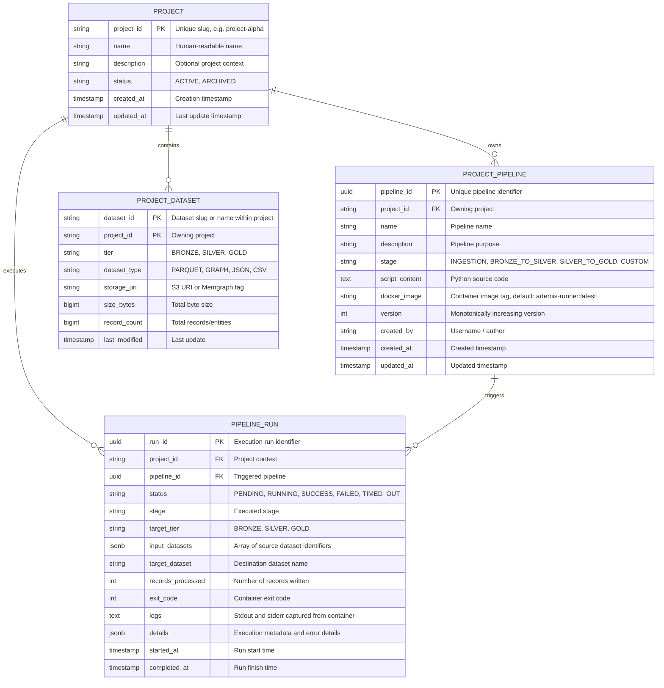

# Data Model: Project-Scoped Data Ingestion & Medallion Pipelines

**Feature**: `004-project-data-pipelines` | **Date**: 2026-10-12

---

## 1. Relational Entities (PostgreSQL)



---

## 2. Storage Entities (MinIO & Memgraph)

### 2.1 MinIO Parquet Partitioning Scheme
Every project and tier is mapped to a dedicated S3 hierarchy:
```text
telemetry/
└── projects/
    └── {project_id}/
        ├── bronze/
        │   └── {dataset_name}/
        │       └── year=YYYY/month=MM/day=DD/raw_batch_{ts}_{uuid}.parquet (or .jsonl/.csv)
        ├── silver/
        │   └── {dataset_name}/
        │       └── year=YYYY/month=MM/day=DD/clean_batch_{ts}_{uuid}.parquet
        └── gold/
            └── {dataset_name}/
                └── year=YYYY/month=MM/day=DD/curated_batch_{ts}_{uuid}.parquet
```

### 2.2 Memgraph Graph Isolation Model
Entities ingested or extracted via project pipelines are tagged with `project_id`:
```cypher
(:LABEL {
    name: $name,
    project_id: $project_id,
    confidence: $confidence,
    tier: $tier,
    ...properties
})
```
Relationships:
```cypher
(a)-[:RELATIONSHIP {project_id: $project_id, tier: $tier, ...properties}]->(b)
```

---

## 3. Pydantic Domain Contracts

### 3.1 Project Contracts
```python
from datetime import datetime
from typing import Optional, List, Dict, Any
from pydantic import BaseModel, Field

class ProjectCreateContract(BaseModel):
    project_id: str = Field(..., pattern=r"^[a-z0-9-_]+$", max_length=64)
    name: str = Field(..., min_length=1, max_length=128)
    description: Optional[str] = None

class ProjectResponseContract(BaseModel):
    project_id: str
    name: str
    description: Optional[str]
    status: str
    created_at: datetime
    updated_at: datetime
```

### 3.2 Pipeline & Script Contracts
```python
class PipelineCreateContract(BaseModel):
    name: str
    description: Optional[str] = None
    stage: str = Field(default="BRONZE_TO_SILVER") # INGESTION, BRONZE_TO_SILVER, SILVER_TO_GOLD, CUSTOM
    script_content: str
    docker_image: str = "artemis-pipeline-runner:latest"

class PipelineUpdateContract(BaseModel):
    name: Optional[str] = None
    description: Optional[str] = None
    stage: Optional[str] = None
    script_content: Optional[str] = None
    docker_image: Optional[str] = None

class PipelineResponseContract(BaseModel):
    pipeline_id: str
    project_id: str
    name: str
    description: Optional[str]
    stage: str
    docker_image: str
    version: int
    created_by: str
    created_at: datetime
    updated_at: datetime
```

### 3.3 Pipeline Run Contracts
```python
class PipelineRunTriggerContract(BaseModel):
    input_data: Optional[Dict[str, Any]] = None
    input_datasets: List[str] = Field(default_factory=list)
    target_dataset: str
    target_tier: str = Field(default="SILVER") # BRONZE, SILVER, GOLD
    parameters: Dict[str, Any] = Field(default_factory=dict)
    timeout_seconds: int = 300

class PipelineRunResponseContract(BaseModel):
    run_id: str
    project_id: str
    pipeline_id: str
    status: str # PENDING, RUNNING, SUCCESS, FAILED, TIMED_OUT
    stage: str
    target_tier: str
    target_dataset: str
    records_processed: int
    duration_ms: int
    exit_code: Optional[int]
    logs: Optional[str]
    started_at: datetime
    completed_at: Optional[datetime]
```
