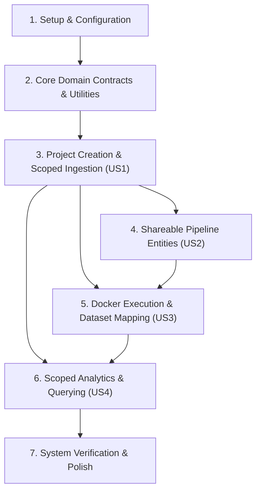

# Tasks: Project-Scoped Data Ingestion & Medallion Script Pipelines

**Feature**: `004-project-data-pipelines` | **Date**: 2026-10-12 | **Spec**: [spec.md](./spec.md) | **Plan**: [plan.md](./plan.md)

---

## 1. Setup & Configuration

**Purpose**: Database schema initialization, configuration updates, and Docker runner environment preparation.

- [X] T001 Define relational schema for projects, pipelines, runs, and datasets in src/config/postgres_init.sql
- [X] T002 [P] Configure Docker runner image tag, execution timeout, and project storage settings in src/config/settings.py
- [X] T003 [P] Create pipeline runner Dockerfile and dependencies in docker/runner/Dockerfile

---

## 2. Core Domain Contracts & Utilities

**Purpose**: Core infrastructure, domain contracts, and shared execution utilities required for full system operation.

- [X] T004 Implement project domain Pydantic contracts in src/domains/project/models/contract/project.py
- [X] T005 [P] Implement project pipeline and execution run Pydantic contracts in src/domains/pipeline/models/contract/project_pipeline.py
- [X] T006 [P] Implement MinIO project tier partitioning and path resolver in src/domains/project/operations/s3_storage.py
- [X] T007 [P] Implement Memgraph project tagging helper for node and relationship ingestion in src/domains/project/operations/graph_storage.py
- [X] T008 Implement ephemeral Docker container runner lifecycle utility in src/domains/pipeline/operations/docker_runner.py

---

## 3. Project Creation & Scoped Data Ingestion

**Goal**: Enable creation and management of isolated projects, raw tabular data ingestion into Bronze MinIO partitions, and graph data ingestion into Memgraph tagged with project identifiers.

### Tests for Project Ingestion

- [X] T009 [P] [US1] Contract tests for project CRUD and ingestion API endpoints in tests/contract/test_project_contracts.py
- [X] T010 [P] [US1] Integration tests for project lifecycle and scoped data ingestion in tests/integration/test_project_lifecycle.py

### Implementation for Project Ingestion

- [X] T011 [US1] Implement PostgreSQL Project persistence and CRUD operations in src/domains/project/operations/project_manager.py
- [X] T012 [US1] Implement Bronze tabular and graph ingestion operations in src/domains/project/operations/scoped_ingestion.py
- [X] T013 [US1] Implement ProjectFacade unifying project operations in src/domains/project/facade/project.py
- [X] T014 [US1] Implement FastAPI routes for project CRUD and ingestion in src/domains/project/api/routes.py
- [X] T015 [US1] Register project router in main application gateway in src/api.py
- [X] T016 [US1] Implement Click CLI subcommands for project create, list, info, delete, and ingest in src/cli/commands/project.py
- [X] T017 [US1] Register project command group in CLI root entrypoint in src/cli/main.py

---

## 4. Shareable Pipeline Entities & Script Management

**Goal**: Support creating, updating, retrieving, and deleting first-class shareable `Pipeline` entities within projects containing validated Python transformation scripts.

### Tests for Pipeline Management

- [X] T018 [P] [US2] Contract tests for pipeline CRUD endpoints in tests/contract/test_project_pipeline_contract.py
- [X] T019 [P] [US2] Integration tests for pipeline script AST validation and versioning in tests/integration/test_pipeline_management.py

### Implementation for Pipeline Management

- [X] T020 [P] [US2] Implement Python AST script syntax validator in src/domains/pipeline/operations/script_validator.py
- [X] T021 [US2] Implement PostgreSQL Pipeline entity CRUD operations and version tracking in src/domains/pipeline/operations/pipeline_manager.py
- [X] T022 [US2] Extend PipelineFacade with project pipeline management methods in src/domains/pipeline/facade/pipeline.py
- [X] T023 [US2] Implement FastAPI routes for project pipeline CRUD in src/domains/pipeline/api/routes.py
- [X] T024 [US2] Implement Click CLI subcommands for pipeline create, list, get, update, and delete in src/cli/commands/project.py

---

## 5. Ephemeral Docker Runner & Pipeline Execution

**Goal**: Execute user pipeline scripts inside isolated ephemeral Docker containers with dataset mapping (input datasets -> target dataset across Bronze, Silver, Gold tiers) and persistent run audit logging.

### Tests for Docker Execution

- [X] T025 [P] [US3] Unit and contract tests for Docker runner volume staging and execution in tests/contract/test_docker_runner_contract.py
- [X] T026 [P] [US3] Integration tests for end-to-end containerized pipeline execution with dataset mapping in tests/integration/test_docker_pipeline_runner.py

### Implementation for Docker Execution

- [X] T027 [US3] Implement dataset staging, input mounting, and output collection in src/domains/pipeline/operations/dataset_stager.py
- [X] T028 [US3] Implement pipeline execution coordinator with timeout enforcement and run recording in src/domains/pipeline/operations/pipeline_executor.py
- [X] T029 [US3] Extend PipelineFacade with execution run triggering and run retrieval in src/domains/pipeline/facade/pipeline.py
- [X] T030 [US3] Implement FastAPI endpoint for triggering pipeline runs in src/domains/pipeline/api/routes.py
- [X] T031 [US3] Implement Click CLI subcommand for pipeline run in src/cli/commands/project.py

---

## 6. Project-Scoped Analytical & Knowledge Graph Querying

**Goal**: Provide project-scoped analytics and inspection, allowing analysts to run DuckDB SQL queries over project partitions, inspect graph networks, and review execution histories.

### Tests for Analytical Querying

- [X] T032 [P] [US4] Integration tests for project-scoped analytics queries and run history retrieval in tests/integration/test_project_queries.py

### Implementation for Analytical Querying

- [X] T033 [US4] Implement project-scoped DuckDB query executor with S3 prefix confinement in src/domains/analytics/operations/project_query.py
- [X] T034 [US4] Implement FastAPI endpoints for project query and pipeline run history in src/domains/project/api/routes.py
- [X] T035 [US4] Implement Click CLI subcommands for project query and pipeline runs history in src/cli/commands/project.py

---

## 7. System Verification & Polish

**Purpose**: End-to-end verification, documentation updates, security hardening, and test cleanup guarantees.

- [X] T036 [P] Update platform documentation and CLI command reference in README.md
- [X] T037 Execute and validate complete walkthrough scenarios from specs/004-project-data-pipelines/quickstart.md
- [X] T038 Verify automated test suite resource cleanup fixtures to guarantee zero database or container residue
- [X] T039 Run complete test suite with mock_mode=True to verify zero-JVM compliance and zero AI budget burn

---

## Dependencies & Execution Order

### Section Dependencies

- **Setup & Configuration (Section 1)**: No dependencies - starts immediately.
- **Core Domain Contracts & Utilities (Section 2)**: Depends on Setup (Section 1).
- **Project Ingestion (Section 3)**: Depends on Section 2.
- **Pipeline Management (Section 4)**: Depends on Section 2 and Section 3 project entities.
- **Docker Execution (Section 5)**: Depends on Section 3 datasets and Section 4 pipelines.
- **Analytics & Querying (Section 6)**: Depends on Section 3 datasets and Section 5 runs.
- **System Verification & Polish (Section 7)**: Depends on all implementation sections being complete.

### Section Flow

### Parallel Opportunities

- **Section 1**: T002 (`settings.py`) and T003 (`docker/runner/Dockerfile`) can run in parallel.
- **Section 2**: T005 (`project_pipeline.py`), T006 (`s3_storage.py`), and T007 (`graph_storage.py`) can run in parallel.
- **Section 3**: T009 (contract test) and T010 (integration test) can run in parallel.
- **Section 4**: T018 (contract test), T019 (integration test), and T020 (`script_validator.py`) can run in parallel.
- **Section 5**: T025 (runner contract test) and T026 (runner integration test) can run in parallel.
- **Section 6**: T032 (query integration test) can run in parallel.
- **Section 7**: T036 (docs update) can run in parallel with T037/T038.

---

## Implementation Strategy: Unified Full Delivery

All capabilities (project management, data ingestion, shareable pipelines, Docker-sandboxed execution, and scoped analytics) are implemented and verified in a single complete delivery:

1. **Infrastructure & Contracts**: Schema, settings, runner image, Pydantic contracts, and S3/Memgraph storage helpers.
2. **Project Ingestion & Pipelines**: Project CRUD, tabular/graph ingestion, script validation, and pipeline entity CRUD.
3. **Execution & Analytics**: Ephemeral Docker runner, dataset staging, run tracking, DuckDB analytical queries, and history endpoints.
4. **Interfaces**: Unified CLI (`artemis project ...`) and FastAPI REST endpoints.
5. **Full System Verification**: End-to-end integration tests and quickstart walkthrough validation.
