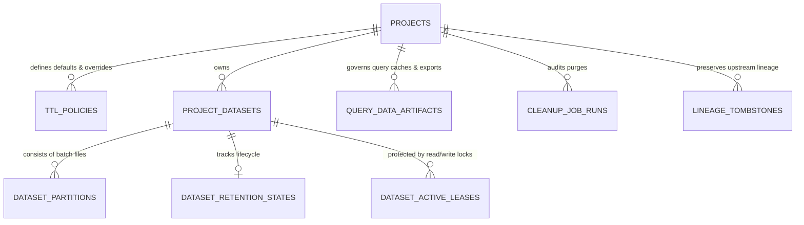
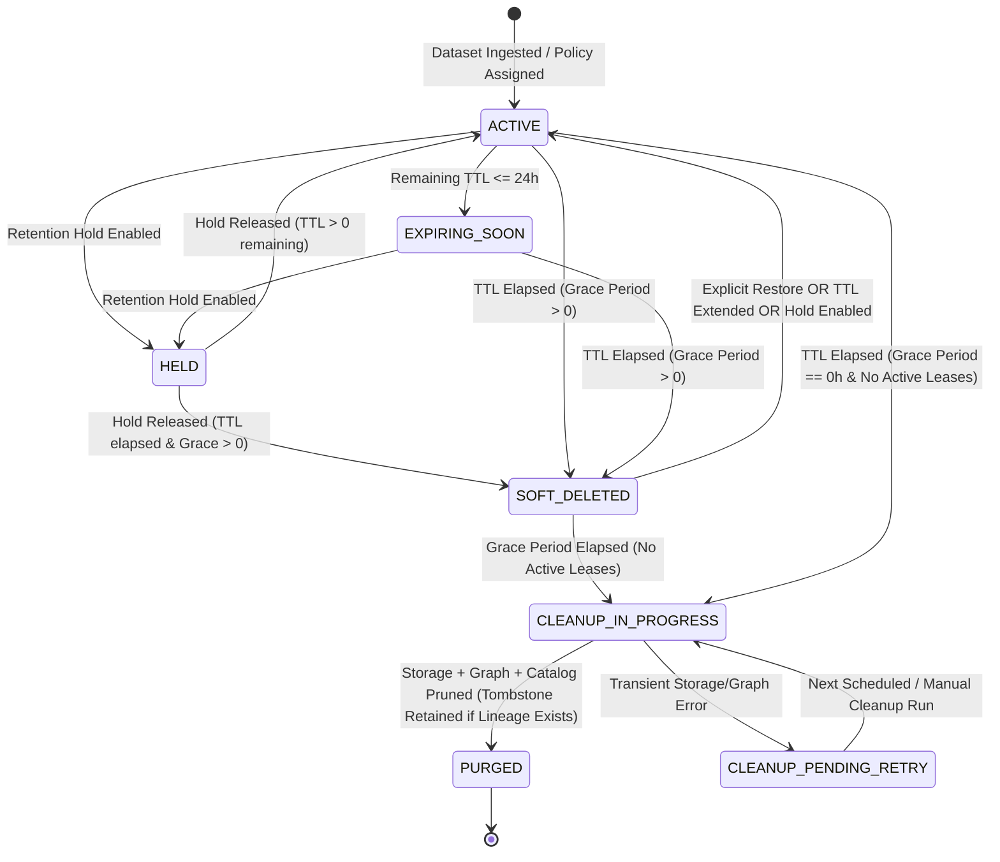

# Data Model: Dataset & Query Data TTL Management and Automated Cleanup

**Feature**: `009-dataset-ttl-cleanup`  
**Date**: 2026-11-21  
**Spec**: [spec.md](./spec.md) | **Research**: [research.md](./research.md)

---

## 1. Entity-Relationship Overview

---

## 2. Relational Schema (PostgreSQL)

All tables are added idempotently to `src/config/postgres_init.sql` and managed by `RetentionRepository` (`src/domains/retention/operations/retention_repository.py`).

### 2.1 `ttl_policies` (`TTLPolicy`)
Stores hierarchical retention policies at the `PLATFORM`, `PROJECT`, `TIER` (Bronze/Silver/Gold), `DATASET`, or `QUERY_DATA` scope.

| Column | Type | Constraints | Description |
|--------|------|-------------|-------------|
| `policy_id` | `UUID` | `PRIMARY KEY DEFAULT gen_random_uuid()` | Unique identifier for the policy |
| `project_id` | `VARCHAR(64)` | `REFERENCES projects(project_id) ON DELETE CASCADE` | Owning project (`NULL` only for global platform defaults) |
| `target_scope` | `VARCHAR(32)` | `NOT NULL` | Enum: `PLATFORM`, `PROJECT`, `TIER`, `DATASET`, `QUERY_DATA` |
| `tier` | `VARCHAR(32)` | `NULL` | `BRONZE`, `SILVER`, `GOLD` (populated when `target_scope` in `TIER`, `DATASET`) |
| `dataset_id` | `VARCHAR(128)` | `NULL` | Populated when `target_scope = 'DATASET'` |
| `query_artifact_type` | `VARCHAR(32)` | `NULL` | Enum: `SQL_RESULT_CACHE`, `AI_RAG_CACHE`, `MATERIALIZED_EXPORT`, `QUERY_HISTORY_LOG` (when `target_scope = 'QUERY_DATA'`) |
| `ttl_expression` | `VARCHAR(32)` | `NOT NULL` | Human-readable string: e.g., `30d`, `24h`, `7d`, `1h`, `never` |
| `ttl_seconds` | `BIGINT` | `NULL` | Normalized duration in seconds (`NULL` when `ttl_expression = 'never'`) |
| `granularity` | `VARCHAR(32)` | `NOT NULL DEFAULT 'INGESTION_AGE'` | Enum: `INGESTION_AGE` (default), `TIMESTAMP_COLUMN` |
| `timestamp_column` | `VARCHAR(128)` | `NULL` | Column name for row/partition event-timestamp evaluation when `granularity = 'TIMESTAMP_COLUMN'` |
| `grace_period_expression` | `VARCHAR(32)` | `NOT NULL DEFAULT '24h'` | Human-readable soft-delete grace period (e.g., `24h`, `0h` for immediate purge) |
| `grace_period_seconds` | `BIGINT` | `NOT NULL DEFAULT 86400` | Grace period in seconds (`0` for immediate hard purge) |
| `updated_by` | `VARCHAR(64)` | `NOT NULL DEFAULT 'admin'` | User ID who created/updated the policy |
| `created_at` | `TIMESTAMPTZ` | `DEFAULT CURRENT_TIMESTAMP` | Creation timestamp (UTC) |
| `updated_at` | `TIMESTAMPTZ` | `DEFAULT CURRENT_TIMESTAMP` | Last update timestamp (UTC) |

**Uniqueness & Validation Rules**:
- Unique index on `(COALESCE(project_id, '__GLOBAL__'), target_scope, COALESCE(tier, ''), COALESCE(dataset_id, ''), COALESCE(query_artifact_type, ''))`.
- `ttl_seconds` MUST be `> 0` (minimum `60` seconds / `1m` in production; `>= 1` second allowed for test runs) or `NULL` (`never`). Negative or zero TTL durations are rejected (`FR-001`).
- `grace_period_seconds` MUST be `>= 0`.
- If `granularity = 'TIMESTAMP_COLUMN'`, `timestamp_column` MUST be non-empty.

---

### 2.2 `dataset_retention_states` (`DatasetRetentionState`)
Tracks the computed lifecycle state, hold flag, and soft-delete/purge timestamps for each project dataset.

| Column | Type | Constraints | Description |
|--------|------|-------------|-------------|
| `project_id` | `VARCHAR(64)` | `NOT NULL REFERENCES projects(project_id) ON DELETE CASCADE` | Project identifier |
| `dataset_id` | `VARCHAR(128)` | `NOT NULL` | Dataset identifier |
| `tier` | `VARCHAR(32)` | `NOT NULL DEFAULT 'BRONZE'` | `BRONZE`, `SILVER`, `GOLD` |
| `effective_policy_id` | `UUID` | `NULL REFERENCES ttl_policies(policy_id) ON DELETE SET NULL` | Resolved policy ID |
| `policy_source` | `VARCHAR(32)` | `NOT NULL DEFAULT 'TIER_DEFAULT'` | Enum: `DATASET_EXPLICIT`, `TIER_DEFAULT`, `PROJECT_DEFAULT`, `PLATFORM_DEFAULT` |
| `effective_ttl_expression` | `VARCHAR(32)` | `NOT NULL DEFAULT '30d'` | Effective TTL expression |
| `effective_ttl_seconds` | `BIGINT` | `NULL` | Effective TTL in seconds (`NULL` = `never`) |
| `granularity` | `VARCHAR(32)` | `NOT NULL DEFAULT 'INGESTION_AGE'` | `INGESTION_AGE` or `TIMESTAMP_COLUMN` |
| `timestamp_column` | `VARCHAR(128)` | `NULL` | Configured event timestamp attribute |
| `grace_period_seconds` | `BIGINT` | `NOT NULL DEFAULT 86400` | Effective grace period in seconds |
| `reference_timestamp` | `TIMESTAMPTZ` | `NOT NULL DEFAULT CURRENT_TIMESTAMP` | Earliest active partition `ingested_at` (or dataset overwrite timestamp) |
| `expires_at` | `TIMESTAMPTZ` | `NULL` | `reference_timestamp + effective_ttl_seconds` (`NULL` if `never` or held) |
| `soft_deleted_at` | `TIMESTAMPTZ` | `NULL` | Timestamp when transitioned to `SOFT_DELETED` |
| `purge_after` | `TIMESTAMPTZ` | `NULL` | `soft_deleted_at + grace_period_seconds` |
| `purged_at` | `TIMESTAMPTZ` | `NULL` | Timestamp when physical purge completed |
| `retention_hold` | `BOOLEAN` | `NOT NULL DEFAULT FALSE` | Legal/investigative hold flag (`FR-010`) |
| `hold_reason` | `TEXT` | `NULL` | Optional reason provided when placing a hold |
| `held_by` | `VARCHAR(64)` | `NULL` | User ID who toggled the hold |
| `lifecycle_status` | `VARCHAR(32)` | `NOT NULL DEFAULT 'ACTIVE'` | Enum: `ACTIVE`, `EXPIRING_SOON`, `HELD`, `SOFT_DELETED`, `CLEANUP_IN_PROGRESS`, `CLEANUP_PENDING_RETRY`, `PURGED` |
| `last_error` | `TEXT` | `NULL` | Populated if `lifecycle_status = 'CLEANUP_PENDING_RETRY'` |
| `last_evaluated_at` | `TIMESTAMPTZ` | `DEFAULT CURRENT_TIMESTAMP` | Last lifecycle evaluation timestamp |

- **Primary Key**: `(project_id, dataset_id, tier)`

---

### 2.3 `dataset_partitions` (`DatasetPartition`)
Tracks per-file/partition ingestion clocks and event-timestamp bounds to support incremental appends vs. overwrites (`FR-002`) and single-pass Parquet compaction (`FR-006`).

| Column | Type | Constraints | Description |
|--------|------|-------------|-------------|
| `partition_id` | `UUID` | `PRIMARY KEY DEFAULT gen_random_uuid()` | Unique partition/file record ID |
| `project_id` | `VARCHAR(64)` | `NOT NULL REFERENCES projects(project_id) ON DELETE CASCADE` | Project identifier |
| `dataset_id` | `VARCHAR(128)` | `NOT NULL` | Dataset identifier |
| `tier` | `VARCHAR(32)` | `NOT NULL DEFAULT 'BRONZE'` | Medallion tier |
| `object_key` | `TEXT` | `NOT NULL` | MinIO S3 object key |
| `storage_uri` | `TEXT` | `NOT NULL` | Full `s3://<bucket>/<object_key>` URI |
| `size_bytes` | `BIGINT` | `NOT NULL DEFAULT 0` | File size in bytes |
| `record_count` | `BIGINT` | `NOT NULL DEFAULT 0` | Number of rows in this file |
| `ingested_at` | `TIMESTAMPTZ` | `NOT NULL DEFAULT CURRENT_TIMESTAMP` | Per-file ingestion timestamp |
| `min_event_ts` | `TIMESTAMPTZ` | `NULL` | Minimum value of `timestamp_column` in this file |
| `max_event_ts` | `TIMESTAMPTZ` | `NULL` | Maximum value of `timestamp_column` in this file |
| `lifecycle_status` | `VARCHAR(32)` | `NOT NULL DEFAULT 'ACTIVE'` | Enum: `ACTIVE`, `SOFT_DELETED`, `PURGED` |
| `soft_deleted_at` | `TIMESTAMPTZ` | `NULL` | Populated when file is soft-deleted |

---

### 2.4 `query_data_artifacts` (`QueryDataArtifact`)
Tracks lifecycle metadata for query caches, materialized query exports, and query audit logs (`FR-003`, `FR-004`).

| Column | Type | Constraints | Description |
|--------|------|-------------|-------------|
| `artifact_id` | `VARCHAR(128)` | `PRIMARY KEY` | Cache key hash, export ID, or log batch ID |
| `project_id` | `VARCHAR(64)` | `NULL REFERENCES projects(project_id) ON DELETE CASCADE` | Scoped project ID (`NULL` for global queries) |
| `artifact_type` | `VARCHAR(32)` | `NOT NULL` | Enum: `SQL_RESULT_CACHE`, `AI_RAG_CACHE`, `MATERIALIZED_EXPORT`, `QUERY_HISTORY_LOG` |
| `storage_uri` | `TEXT` | `NOT NULL` | `redis://<key>`, `s3://...`, or `postgres://ai_queries/<id>` |
| `source_datasets` | `JSONB` | `NOT NULL DEFAULT '[]'::jsonb` | List of `{"project_id": ..., "dataset_id": ..., "tier": ...}` dependencies |
| `size_bytes` | `BIGINT` | `NOT NULL DEFAULT 0` | Byte size of stored query result/export |
| `ttl_expression` | `VARCHAR(32)` | `NOT NULL` | Assigned TTL expression (e.g., `1h`, `7d`, `30d`) |
| `ttl_seconds` | `BIGINT` | `NULL` | Duration in seconds |
| `created_at` | `TIMESTAMPTZ` | `NOT NULL DEFAULT CURRENT_TIMESTAMP` | Creation timestamp |
| `expires_at` | `TIMESTAMPTZ` | `NULL` | Computed expiration timestamp |
| `soft_deleted_at` | `TIMESTAMPTZ` | `NULL` | Soft-delete timestamp (for `MATERIALIZED_EXPORT`) |
| `purge_after` | `TIMESTAMPTZ` | `NULL` | Permanent purge timestamp |
| `retention_hold` | `BOOLEAN` | `NOT NULL DEFAULT FALSE` | Retention hold flag |
| `lifecycle_status` | `VARCHAR(32)` | `NOT NULL DEFAULT 'ACTIVE'` | Enum: `ACTIVE`, `SOFT_DELETED`, `PURGED` |

---

### 2.5 `dataset_active_leases` (`DatasetActiveLease`)
Lightweight concurrency lock registry ensuring active queries, pipeline runs, and ingestions are never corrupted by background cleanup (`FR-011`).

| Column | Type | Constraints | Description |
|--------|------|-------------|-------------|
| `lease_id` | `UUID` | `PRIMARY KEY DEFAULT gen_random_uuid()` | Unique lease identifier |
| `project_id` | `VARCHAR(64)` | `NOT NULL` | Project identifier |
| `dataset_id` | `VARCHAR(128)` | `NOT NULL` | Locked dataset identifier (`*` for project-wide wildcard query) |
| `operation_type` | `VARCHAR(32)` | `NOT NULL` | Enum: `INGESTION`, `PIPELINE_RUN`, `ANALYTICAL_QUERY` |
| `holder_id` | `VARCHAR(128)` | `NOT NULL` | Run ID, request ID, or PID |
| `acquired_at` | `TIMESTAMPTZ` | `NOT NULL DEFAULT CURRENT_TIMESTAMP` | Lease start time |
| `expires_at` | `TIMESTAMPTZ` | `NOT NULL` | Auto-expiry timestamp (`acquired_at + timeout`) to prevent deadlocks |

---

### 2.6 `cleanup_job_runs` (`CleanupJobRun`)
Immutable audit log for all scheduled, manual, and dry-run cleanup executions (`FR-012`, `SC-007`).

| Column | Type | Constraints | Description |
|--------|------|-------------|-------------|
| `run_id` | `UUID` | `PRIMARY KEY DEFAULT gen_random_uuid()` | Unique cleanup execution ID |
| `trigger_type` | `VARCHAR(32)` | `NOT NULL` | Enum: `SCHEDULED`, `MANUAL`, `DRY_RUN` |
| `project_id` | `VARCHAR(64)` | `NULL` | Scoped project ID (`NULL` for global sweep) |
| `initiated_by` | `VARCHAR(64)` | `NOT NULL DEFAULT 'system'` | User ID or `system` scheduler |
| `status` | `VARCHAR(32)` | `NOT NULL DEFAULT 'RUNNING'` | Enum: `RUNNING`, `SUCCESS`, `PARTIAL_FAILURE`, `FAILED` |
| `datasets_evaluated` | `INTEGER` | `NOT NULL DEFAULT 0` | Number of datasets inspected |
| `datasets_soft_deleted` | `INTEGER` | `NOT NULL DEFAULT 0` | Number of datasets newly moved to `SOFT_DELETED` |
| `datasets_purged` | `INTEGER` | `NOT NULL DEFAULT 0` | Number of datasets permanently purged |
| `partitions_compacted` | `INTEGER` | `NOT NULL DEFAULT 0` | Number of `timestamp_column` Parquet files compacted/rewritten |
| `rows_pruned` | `BIGINT` | `NOT NULL DEFAULT 0` | Number of expired rows pruned during compaction |
| `query_artifacts_purged` | `INTEGER` | `NOT NULL DEFAULT 0` | Number of query caches/exports/logs purged |
| `graph_elements_pruned` | `INTEGER` | `NOT NULL DEFAULT 0` | Number of orphaned Memgraph nodes/edges removed |
| `tombstones_created` | `INTEGER` | `NOT NULL DEFAULT 0` | Number of `LineageTombstone` records created |
| `bytes_reclaimed` | `BIGINT` | `NOT NULL DEFAULT 0` | Total storage bytes freed (or estimated in `DRY_RUN`) |
| `skipped_held_count` | `INTEGER` | `NOT NULL DEFAULT 0` | Datasets skipped due to `retention_hold = true` |
| `skipped_locked_count` | `INTEGER` | `NOT NULL DEFAULT 0` | Datasets skipped due to active query/pipeline leases |
| `candidate_items` | `JSONB` | `NOT NULL DEFAULT '[]'::jsonb` | Detailed list of affected/previewed items |
| `errors` | `JSONB` | `NOT NULL DEFAULT '[]'::jsonb` | Structured error details if `PARTIAL_FAILURE` or `FAILED` |
| `started_at` | `TIMESTAMPTZ` | `NOT NULL DEFAULT CURRENT_TIMESTAMP` | Execution start timestamp |
| `completed_at` | `TIMESTAMPTZ` | `NULL` | Execution completion timestamp |
| `duration_ms` | `INTEGER` | `NOT NULL DEFAULT 0` | Execution duration in milliseconds |

---

### 2.7 `lineage_tombstones` (`LineageTombstone`)
Relational catalog mirror of Memgraph `:LineageTombstone` nodes preserving provenance after an upstream dataset is purged (`FR-009`).

| Column | Type | Constraints | Description |
|--------|------|-------------|-------------|
| `project_id` | `VARCHAR(64)` | `NOT NULL REFERENCES projects(project_id) ON DELETE CASCADE` | Project identifier |
| `dataset_id` | `VARCHAR(128)` | `NOT NULL` | Original dataset identifier |
| `tier` | `VARCHAR(32)` | `NOT NULL` | Original Medallion tier |
| `applied_ttl_expression` | `VARCHAR(32)` | `NOT NULL` | TTL expression that triggered purge |
| `purged_at` | `TIMESTAMPTZ` | `NOT NULL DEFAULT CURRENT_TIMESTAMP` | Purge timestamp |
| `upstream_datasets` | `JSONB` | `NOT NULL DEFAULT '[]'::jsonb` | Upstream dataset IDs |
| `downstream_datasets` | `JSONB` | `NOT NULL DEFAULT '[]'::jsonb` | Surviving downstream dataset IDs |
| `cleanup_run_id` | `UUID` | `NULL REFERENCES cleanup_job_runs(run_id) ON DELETE SET NULL` | Cleanup run that created the tombstone |

- **Primary Key**: `(project_id, dataset_id, tier)`

---

## 3. Graph Schema Extensions (Memgraph)

- **`(:DataResource)` Nodes**:
  - Added properties:
    - `lifecycle_status`: `'ACTIVE' | 'SOFT_DELETED' | 'PURGED'` (default `'ACTIVE'`)
    - `expires_at`: ISO-8601 UTC string or `null`
    - `soft_deleted_at`: ISO-8601 UTC string or `null`
    - `purged_at`: ISO-8601 UTC string or `null`
    - `applied_ttl`: string (e.g., `'30d'`)
  - When a `DataResource` with downstream `DERIVED_FROM` edges is purged, it gains the `:LineageTombstone` label (`SET r:LineageTombstone, r.lifecycle_status = 'PURGED'`), while its `(:DataAttribute)` children and `[:CONTAINS_ENTITY]` edges are deleted.
- **`(:GenericEntity)` & Domain Graph Nodes**:
  - Linked via `(r:DataResource)-[:CONTAINS_ENTITY]->(e:GenericEntity)`.
  - Domain nodes ingested via `ProjectGraphStorage` carry `r.source_datasets = [...]` (list of dataset IDs). During purge of `dataset_id`, `dataset_id` is removed from `source_datasets`, and any node/edge with an empty `source_datasets` list (or `GenericEntity` with zero incoming `CONTAINS_ENTITY` relationships from non-purged `DataResource` nodes) is `DETACH DELETE`d.

---

## 4. Lifecycle State Machine

