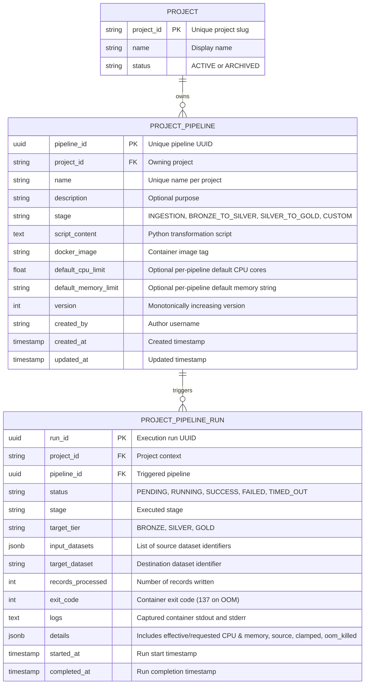

# Data Model: Customizable CPU and Memory Limits for Pipeline Runs

**Feature**: `010-pipeline-resource-limits` | **Date**: 2026-11-21 | **Spec**: [spec.md](./spec.md)

---

## 1. Relational Schema Extensions (PostgreSQL)



### 1.1 `project_pipelines` Table Changes (`src/config/postgres_init.sql`)

Add two nullable columns to `project_pipelines` (plus idempotent `ALTER TABLE` statements for existing installations):

```sql
ALTER TABLE project_pipelines
    ADD COLUMN IF NOT EXISTS default_cpu_limit DOUBLE PRECISION,
    ADD COLUMN IF NOT EXISTS default_memory_limit VARCHAR(32);
```

### 1.2 `project_pipeline_runs.details` JSONB Structure

Each row in `project_pipeline_runs` records its resolved resource allocation inside the `details` JSONB column upon creation and completion:

```json
{
  "storage_uri": "s3://telemetry/projects/alpha/silver/clean/...",
  "size_bytes": 12480,
  "container_id": "a1b2c3d4e5f6",
  "effective_cpu_limit": 2.5,
  "effective_memory_limit": "2048m",
  "requested_cpu_limit": 2.5,
  "requested_memory_limit": "2048m",
  "cpu_source": "run_override",
  "memory_source": "run_override",
  "resource_clamped": false,
  "oom_killed": false
}
```

When a container is killed for exceeding its memory allocation (`exit_code == 137` or Docker `State.OOMKilled == true`), `details` records:

```json
{
  "error": "Out of Memory (OOM): Container killed (exit code 137) after exceeding effective memory limit of 128m.",
  "effective_cpu_limit": 2.0,
  "effective_memory_limit": "128m",
  "requested_cpu_limit": null,
  "requested_memory_limit": "128m",
  "cpu_source": "system_default",
  "memory_source": "run_override",
  "resource_clamped": false,
  "oom_killed": true
}
```

---

## 2. Configuration & Value Objects

### 2.1 `ResourceLimitPolicy` (Derived from `src/config/settings.py`)

| Setting Attribute | Environment Variable | Type | Default | Description |
| :--- | :--- | :--- | :--- | :--- |
| `docker_runner_cpu_limit` | `DOCKER_RUNNER_CPU_LIMIT` | `float` | `2.0` | System default CPU allocation in fractional cores |
| `docker_runner_memory_limit` | `DOCKER_RUNNER_MEMORY_LIMIT` | `str` | `"2g"` | System default memory allocation |
| `docker_runner_max_cpu_limit` | `DOCKER_RUNNER_MAX_CPU_LIMIT` | `float` | `4.0` | Administrator hard maximum CPU cap in cores |
| `docker_runner_max_memory_limit` | `DOCKER_RUNNER_MAX_MEMORY_LIMIT` | `str` | `"4g"` | Administrator hard maximum memory cap |
| `docker_runner_min_cpu_limit` | `DOCKER_RUNNER_MIN_CPU_LIMIT` | `float` | `0.1` | Minimum operational CPU floor in cores |
| `docker_runner_min_memory_limit` | `DOCKER_RUNNER_MIN_MEMORY_LIMIT` | `str` | `"64m"` | Minimum operational memory floor (`64MB` / `67,108,864` bytes) |
| `docker_runner_resource_overflow_policy` | `DOCKER_RUNNER_RESOURCE_OVERFLOW_POLICY` | `str` | `"reject"` | Cap exceedance behavior: `"reject"` or `"clamp"` |

### 2.2 `ResolvedResourceAllocation` (`src/domains/pipeline/operations/resource_validator.py`)

```python
from dataclasses import dataclass
from typing import Optional

@dataclass(frozen=True)
class ResolvedResourceAllocation:
    effective_cpu_limit: float
    effective_memory_limit: str
    effective_memory_bytes: int
    requested_cpu_limit: Optional[float]
    requested_memory_limit: Optional[str]
    cpu_source: str          # "run_override" | "pipeline_default" | "system_default"
    memory_source: str       # "run_override" | "pipeline_default" | "system_default"
    cpu_clamped: bool
    memory_clamped: bool

    @property
    def resource_clamped(self) -> bool:
        return self.cpu_clamped or self.memory_clamped
```

---

## 3. Pydantic Domain Contracts (`src/domains/pipeline/models/contract/project_pipeline.py`)

### 3.1 Pipeline Definition Contracts

```python
class PipelineCreateContract(BaseModel):
    name: str = Field(..., min_length=1, max_length=128, description="Human-readable pipeline name")
    description: Optional[str] = Field(default=None, description="Pipeline purpose description")
    stage: str = Field(default="BRONZE_TO_SILVER", description="Stage: INGESTION, BRONZE_TO_SILVER, SILVER_TO_GOLD, CUSTOM")
    script_content: str = Field(..., min_length=1, description="Python transformation script source")
    docker_image: str = Field(default="artemis-pipeline-runner:latest", description="Docker image tag for execution")
    default_cpu_limit: Optional[float] = Field(default=None, description="Optional pipeline default CPU cores (e.g. 1.5)")
    default_memory_limit: Optional[str] = Field(default=None, description="Optional pipeline default memory limit (e.g. '1g', '512m')")


class PipelineUpdateContract(BaseModel):
    name: Optional[str] = Field(default=None, min_length=1, max_length=128)
    description: Optional[str] = None
    stage: Optional[str] = None
    script_content: Optional[str] = None
    docker_image: Optional[str] = None
    default_cpu_limit: Optional[float] = Field(default=None, description="Updated pipeline default CPU cores")
    default_memory_limit: Optional[str] = Field(default=None, description="Updated pipeline default memory limit")


class PipelineResponseContract(BaseModel):
    pipeline_id: str
    project_id: str
    name: str
    description: Optional[str] = None
    stage: str
    docker_image: str
    default_cpu_limit: Optional[float] = None
    default_memory_limit: Optional[str] = None
    version: int = 1
    created_by: str = "admin"
    created_at: datetime
    updated_at: datetime
```

### 3.2 Pipeline Run Trigger & Response Contracts

```python
class PipelineRunTriggerContract(BaseModel):
    input_data: Optional[Dict[str, Any]] = None
    input_datasets: List[str] = Field(default_factory=list, description="List of source datasets in project")
    target_dataset: str = Field(..., description="Destination dataset identifier")
    target_tier: str = Field(default="SILVER", description="BRONZE, SILVER, or GOLD")
    parameters: Dict[str, Any] = Field(default_factory=dict, description="Custom parameters injected to script environment")
    timeout_seconds: int = Field(default=300, ge=1, le=3600, description="Container execution timeout in seconds")
    cpu_limit: Optional[float] = Field(default=None, description="Optional per-run custom CPU allocation in cores (e.g. 0.5, 2.0)")
    memory_limit: Optional[str] = Field(default=None, description="Optional per-run custom memory allocation (e.g. '512m', '2g')")


class PipelineRunResponseContract(BaseModel):
    run_id: str
    project_id: str
    pipeline_id: str
    status: str  # PENDING, RUNNING, SUCCESS, FAILED, TIMED_OUT
    stage: str
    target_tier: str
    target_dataset: str
    records_processed: int = 0
    duration_ms: int = 0
    exit_code: Optional[int] = None
    logs: Optional[str] = None
    effective_cpu_limit: Optional[float] = None
    effective_memory_limit: Optional[str] = None
    requested_cpu_limit: Optional[float] = None
    requested_memory_limit: Optional[str] = None
    resource_clamped: bool = False
    details: Optional[Dict[str, Any]] = None
    started_at: datetime
    completed_at: Optional[datetime] = None
```

---

## 4. Validation Rules Summary

1. **CPU Format & Floor**:
   - Must be a finite number (`float` or `int`).
   - Must satisfy `cpu >= settings.docker_runner_min_cpu_limit` (`0.1` cores). Zero or negative values are always rejected with `ValueError`.
2. **Memory Format & Floor**:
   - Must match `^\s*(\d+(?:\.\d+)?)\s*([bkmg]b?)?\s*$` (case-insensitive suffixes: `b`, `k`, `kb`, `m`, `mb`, `g`, `gb`).
   - Normalized byte value must satisfy `memory_bytes >= parse_memory_bytes(settings.docker_runner_min_memory_limit)` (`64m` = `67,108,864` bytes). Zero, negative, below-floor, or unrecognized suffixes (e.g., `2x`, `abc`, `-512m`) are always rejected with `ValueError`.
3. **Administrator Hard Cap Enforcement**:
   - Compared against `max_cpu = settings.docker_runner_max_cpu_limit` and `max_mem_bytes = parse_memory_bytes(settings.docker_runner_max_memory_limit)`.
   - Under `DOCKER_RUNNER_RESOURCE_OVERFLOW_POLICY=reject` (default): any explicit request where `cpu > max_cpu` or `memory_bytes > max_mem_bytes` raises `ValueError` before container launch or pipeline save.
   - Under `DOCKER_RUNNER_RESOURCE_OVERFLOW_POLICY=clamp`: explicit requests exceeding `max_cpu` or `max_mem_bytes` are clamped to `max_cpu` / `settings.docker_runner_max_memory_limit` and flagged with `resource_clamped = True`.
   - For fallback values (`pipeline_default` or `system_default`), if the active hard cap is lower than the fallback value, the effective value is always clamped to the hard cap (`FR-008`) and flagged with `resource_clamped = True`.
